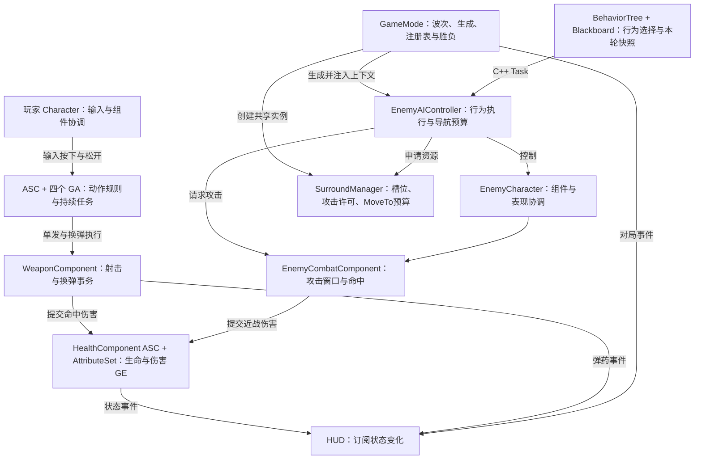
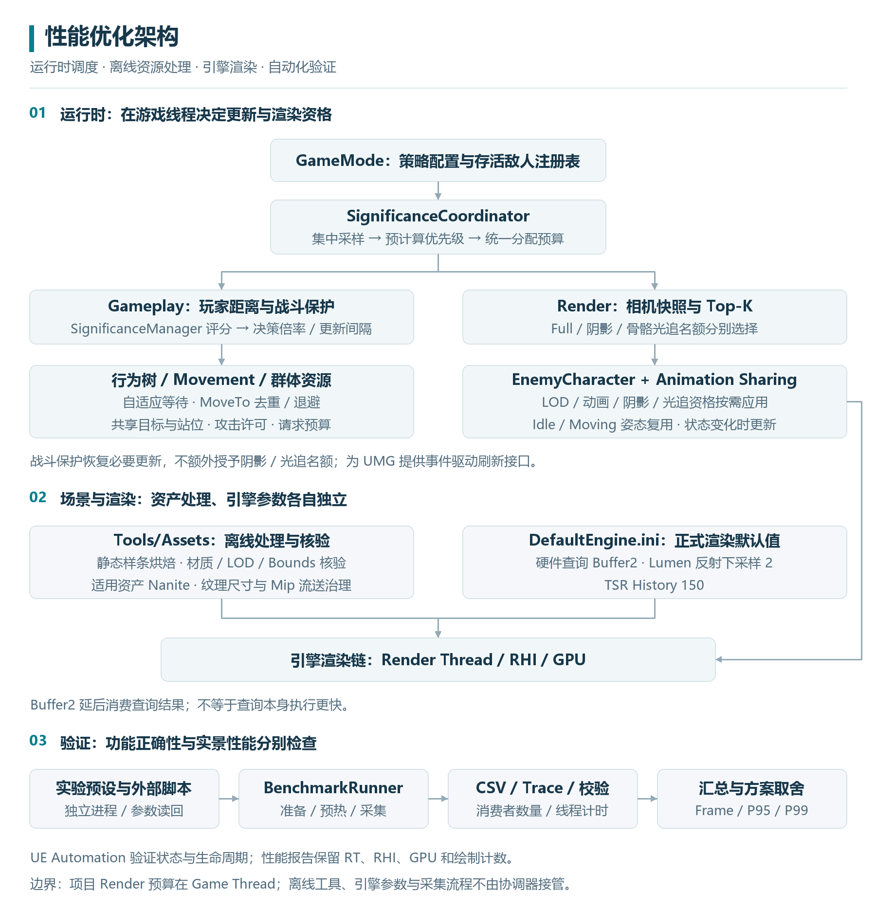
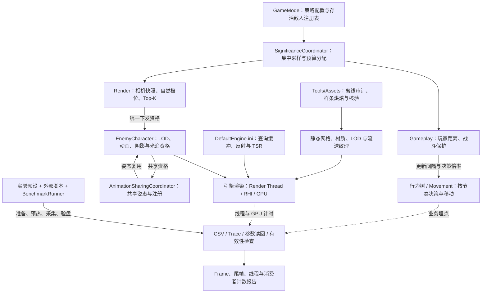
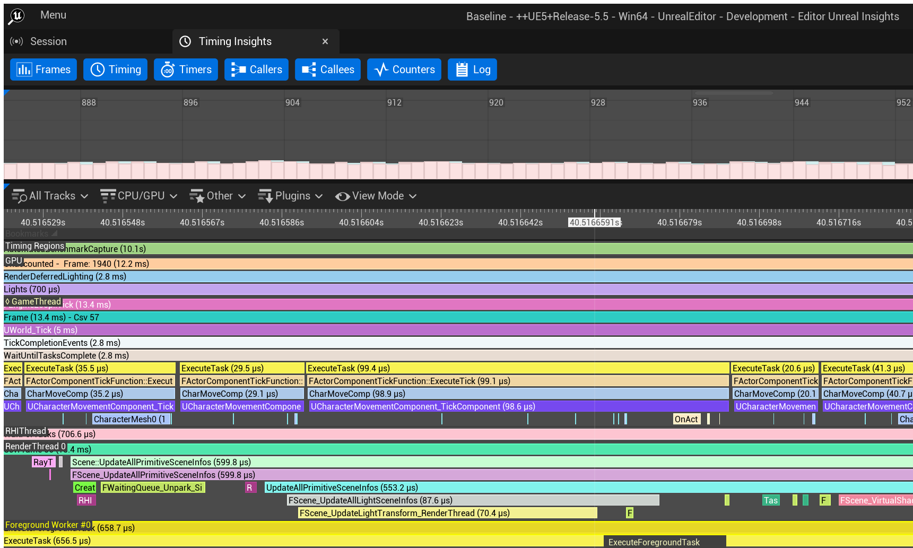

# fpstrue · UE5 C++ FPS

基于 Unreal Engine 5.5 和 C++ 的 FPS Demo。当前 `codex/multiplayer-fps` 分支提供专用服务器 PvPvE：玩家之间可以互相伤害，也能与 AI 敌人交战。GAS 管理开火、换弹、瞄准和冲刺，服务器维护生命、伤害、计分及重生；同时保留单机 PvE 的群体调度及性能测试。历史单机 160 敌人、2026-10-18 联网世界血条专项和 2026-10-20 联网平地 160 AI 基线分别保留场景、构建和验收边界，均不能直接当作公网多人容量。

> `review` 用于完整项目开发与复习，保留 Content 资产和“语法复习”注释；`main` 用于面试展示，不随开发分支自动更新。
> [FPS项目架构、性能与UE机制说明](Docs/FPS_PROJECT_ENGINEERING_NOTES.md)保留复习笔记；最新目录和优化记录以本页及实验报告为准。
> 当前状态归属、阅读顺序和动画回调迁移边界见[代码职责与动作生命周期](Docs/CODE_OWNERSHIP.md)。

项目重点是完整玩法实现、多敌人更新调度，以及从实验数据追到线程依赖的性能归因。

> 本分支提供源码、配置、测试脚本、性能记录和 Git LFS 管理的项目资产；仅供有对应资源使用权限的开发环境使用。`main` 展示分支不分发第三方 Content 资产。

## 项目亮点

- **FPS 玩法架构设计**：角色协调输入与装备，武器组件负责射击和换弹，生命组件统一处理伤害与死亡，GameMode 管理波次、生成与胜负。C++ 实现规则和状态，蓝图接入动画、音效与界面，形成输入、动作、命中、伤害、反馈的完整链路。
- **GAS 动作规则与战斗结算**：四个 GA 统一管理开火、换弹、瞄准和冲刺的激活、互斥及取消；武器只执行单发射击和换弹事务，不再维护另一套动作状态机。换弹通过事务编号和动画播放实例识别回调，统一处理装填提交、完成、中断及超时，防止重复补弹、旧通知误提交和取消后状态残留。
- **多人射击与预测校正**：逐发输入关联装备代际、开火会话和 ShotId，服务器校验射速、时间及弹药后结算并返回 ACK；拥有者预测开火表现，按权威结果纠正弹药，避免重复播放。移动扩展保存瞄准/冲刺模式，服务器用短期身体历史进行部位命中回溯，明确区分动作预测、移动重放与命中补偿。
- **敌人行为树与群体战术协作**：C++ Task、Blackboard 与可编辑行为树组织追击、包围、站位、攻击及低血撤退；EQS 集中筛选接近候选，群体管理分配站位与攻击许可，避免所有敌人同时挤向玩家。低血时按需寻找有遮挡且可达的掩体。MoveTo 结合目标去重、失败退避、帧级预算和请求身份校验，在限制重复寻路的同时保留战斗响应。
- **覆盖 UI、玩法调度与场景渲染的性能优化**：为 UMG 提供事件驱动刷新接口；Gameplay 与 Render 分别评分，通过决策降频、移动分级、Animation Sharing 和阴影/光追预算减少重复工作，战斗时恢复必要更新。有界 Top-K、数据快照和缓冲复用降低调度开销；场景侧结合查询缓冲、反射下采样、静态样条烘焙、TSR 与纹理流送治理，按整帧和尾帧选择方案。具体收益与证据分级见下文。
- **生命周期与资源清理治理**：死亡、销毁和 EndPlay 共用清理入口，停止 AI、移动和 Timer，释放委托、站位、攻击许可与共享动画注册。弱引用注册表、幂等注销及回调重入保护约束对象失效边界；尸体保留需要的表现，撤销不必要的阴影和光追参与。
- **配置抽离，便于策划调参与测试**：波次、近战和武器参数集中到配置资产，蓝图选择表现资源；武器首次装备校验并保存配置快照，共享配置不共享弹药等运行状态。性能实验预设和控制开关集中管理，便于调整规模、预算与采集条件，避免修改参数时穿透业务代码。
- **自动化功能回归与性能测试流程**：当前交付清单登记 101 项 UE Automation 测试，本轮实际通过 101 项（87 clean、14 warned），不以已登记数量代替通过数量。覆盖射击换弹、逐发去重与时序、SavedMove、玩家历史命中、GAS 权限与属性、能力提交取消与同实例重启、单发表现身份、同轮近战保护采样、AI、EQS、低血撤退、生命周期、多人权限与恢复、HUD 重绑定、实际动画素材、死亡掉枪和迟到复制，并检查敌人简化命中体、服务器姿态与本地预算隔离、评分快照等价性、地面缓存失效、独立预算保持、战术队列补位及启动／出生失败。脚部 IK 仅保留玩家贴地与退出边界测试；敌人 IK 已移除。采集配置另有 56 项检查。性能脚本串联场景准备、预热、采集、有效性校验与报告汇总，记录参数读回和输入指纹；功能回归与实景性能采集分开执行，支持修改后的重复验证。

## 目录结构

```text
Config/                     引擎、输入、碰撞与默认资源配置
Source/fpstrue/
  fpstrue.cpp               主模块注册；编译规则保留在模块根目录
  Game/                     波次、生成、注册表与结算；PvP 时钟、计分与重生
  Characters/
    Player/                 玩家控制、SavedMove 与权威身体历史
    Enemies/                敌人角色、近战组件与战斗配置
      AI/                   Controller、行为树、EQS 选点、导航与群体战术资源
      Performance/
        fpstrueEnemyPerformance.h/.cpp
                            Gameplay/Render 分级、Top-K 与动画共享接入
    Shared/                 ASC、生命属性、伤害 GE 与兼容健康事件
  Weapons/
    fpstrueWeaponComponent.h/.cpp
                            拾取、装备、射击、换弹、视觉后坐力与动画通知
    fpstrueWeaponConfig.h/.cpp
                            武器参数资产与整组校验
    fpstrueCombatAbilities.h/.cpp
                            开火/换弹/瞄准/冲刺 GA、输入释放与动作任务
  Runtime/
    fpstrueRuntime.h/.cpp   共享播放身份、碰撞通道、诊断参数快照与业务埋点
  Testing/
    Automation/             按玩法边界、组件、敌人 AI、渲染预算、对局与采集分组回归
    Benchmarks/             采集阶段、资源管理与产物校验
Tools/                      开发与测试工具（见 Tools/README.md）
  Networking/               PvP 构建、双客户端联网验证与版本证据归档
  Gameplay/                 行为树生成/校验与玩法配置迁移
  Assets/                   网格、LOD、Nanite、纹理与样条资产处理
  Performance/              性能采集、Trace 导出、分析与配置校验
    ExperimentProfiles/     实验定义与采集预设
    Charts/                 实验图表生成
  LegacyPerformance/        历史实验采集与汇总
Docs/Performance/           分阶段实验记录
PerformanceEvidence/        可公开的性能截图
```

## 玩法架构

全部代码位于一个 `fpstrue` Runtime 模块内，按业务职责组织目录。



玩家和敌人各自持有生命组件，不共享血量。行为树选择移动或攻击分支，Controller 执行受预算约束的请求，CharacterMovement 执行移动；CombatComponent 执行攻击事务，SurroundManager 只协调群体资源。

GameMode 使用 `Waiting → Starting → Playing → Finished` 表达对局阶段。先校验出生点和玩家，再注入群体上下文，提交完整初始状态后才广播；重复开局和广播期间结束对局都不会重新启动生成队列。

### 射击与换弹

- 玩家输入经过角色接口进入 ASC；开火、换弹、瞄准、冲刺 GA 管理激活、标签互斥与取消，角色从标签更新速度和表现。每发通过同一 ASC 通道的 TargetData 传递角色身份、装备代际、开火会话、ShotId、估计服务器时间和瞄准方向；不传客户端命中结论或伤害。服务器自行确定起点、命中与数值，复制动作枚举仅供展示。
- 原生命组件同时是 ASC，玩家和敌人通过 `IAbilitySystemInterface` 暴露它。`AttributeSet` 保存真实生命数值，瞬时 `GameplayEffect` 执行伤害与重置；原健康接口和委托保留为事件桥，不再独立复制第二份血量。
- 开火能力使用 `LocalPredicted`、`WaitInputRelease` 和等待任务：拥有者先播放枪声、动画与后坐力；服务器逐发校验身份、时间和客户端节奏，最多保留 4 条已准入输入。武器只用一个定时器按绝对射击节拍消费这些事实，不因服务器帧间隔反复累积冷却误差，也不在同次更新爆发补射。正常松开立即结束输入能力，已准入请求保留原装备、会话、瞄准状态和表现编号继续结算；换弹、死亡、卸枪等强取消逐项确认。可靠 ACK 返回该发裁决及权威弹药，快照恢复当前状态；排队重复请求不提前终结，已执行请求不重复扣弹或伤害。预测估计按当前轮次清理，不误清上一轮仍在等待 ACK 的请求。
- `WeaponTrace` 与普通碰撞分开配置：敌人默认 `Simple` 使用六个根变换驱动的原生 `UBoxComponent`（头、躯干、双臂、双腿），不再依赖专用凸包网格或生成工具；保留爆头及部位身份，但不逐骨骼贴合挥动四肢。角色移动胶囊不抢先阻挡该通道。`-EnemyHitProxies=Reference` 恢复原 Mesh／PhysicsAsset 骨骼命中链，供同版本对照。两种模式都不随相机、距离或客户端 RenderTier 切换命中规则。PvP 玩家仍按 PhysicsAsset 的身体球、盒及胶囊识别部位，并保留原历史回溯；缺少可支持形状时不退回移动胶囊冒充精确命中。
- 瞄准取消冲刺，换弹取消并阻止开火、瞄准和冲刺；死亡取消全部能力。冲刺保留按键切换语义，瞄准持续到松开输入；动作规则只在 GA 声明，不由角色和武器重复判断。
- `ReloadId` 与 Mesh、AnimInstance、Montage 实例组成播放身份；手臂和枪械播放由同一事务管理。装填 Notify 校验身份后提交弹药，完成与取消统一清理，超时只解除动作锁。
- 换弹采用 `ServerInitiated`，手动请求和服务器空仓自动换弹共用同一 GA；空仓不绕一次拥有者激活往返。多人模式由服务器配置时长完成装弹，不依赖 Dedicated Server 播放第一人称动画，客户端 Notify 不能补弹；单机模式保留有身份的动画提交与超时。GA 等待真实事务结束，不增加第二份装弹计时。
- 当前多人角色为 `BP_TemplateCharacter`，武器为原生 `AfpstrueTemplateWeapon`；`ABP_TemplateBody`、`ABP_TemplateArms` 和 `ABP_TemplateWeapon` 分别负责全身、第一人称手臂与枪械，规则仍由角色、GAS 和武器事务维护。身体使用方向移动、上半身持枪及瞄准偏移；换弹同时驱动三套 Mesh，并按服务器开始时间补齐中途进度。普通与空仓换弹仍是不同事务，但当前模板共用一套角色换弹视觉，不宣称两套独立素材。原 RAR 资源和兼容路径保留。
- 死亡按职责分层：生命模块提交死亡事实、GAS 结束动作，角色协调松手与身体布娃娃，武器取消旧事务并从全身手部脱落。枪继承死亡前速度，使用 UE 原生物理复制，不再接受拾取，8 秒后回收；旧 Pawn 重生或重连不会提前删枪，迟到装备/附着与初始掉落快照不能把落地枪挂回手边。身体布娃娃是各端表现，不宣称逐骨骼权威同步，也不保证不同客户端在同一渲染帧收到死亡。
- 多人 HUD 使用原 `ingame` 的保留版式 `ingame_network`，由原生 Widget 订阅生命、装备和弹药变化；空手隐藏弹药信息，拾枪后显示枪名与弹药。原始 `ingame`、菜单、暂停及胜负 UMG 资产不改；网络模式仍使用现有死亡重生规则，不以复制一份 Widget 冒充恢复旧单机倒计时和胜负流程。Canvas 仅作明确缺少 UMG 资源时的兜底，不叠加显示两套界面。

多人功能验证使用 `Tools/Networking/RunPvpSmoke.ps1` 启动一个服务器和两个客户端，检查真实输入后的伤害、手动与空仓换弹、击杀、重生及远端姿态。深度门禁要求专用服务器身份、真实位移和双方时钟采样；另按武器 NetGUID、装备代际、会话和 ShotId 核对全部预测、服务器最终裁决和 ACK，检查未决账本归零及表现不重复，单列时间过期、队列超限与明确取消，不再以一发成功代表整轮可靠。`-MovingHit` 是显式开发测试配置，临时关闭散射并要求移动时的真实历史命中、服务器扣血和客户端血量复制证据；它不是正式散射下的完整命中率统计。

已归档的 PvP 构建完成 **Win64 打包客户端 × 2 → 公网 Linux Dedicated Server** 的正常网络与模拟弱网深度门禁：报告分别为 `Saved/Networking/PvpSmoke_20261016_022020_a991b9ac/Report.json` 和 `Saved/Networking/PvpSmoke_20261016_022105_08b0d1f7/Report.json`。两轮均检查实际位移、射击伤害、手动/空仓换弹、死亡重生、远端瞄准/冲刺，以及同一发号的预测、服务器接受、ACK、历史部位命中和表现去重。弱网条件为每个发送方向额外延迟 100 ms、波动参数 20 ms、丢包 2%，不是实测 RTT。该批次不包含随后加入的多人 AI 与短时断线恢复，不能用旧报告代替新增功能的公网验收。

客户端与服务器使用同一源码引擎的 Development 目标，核对构建收据与程序哈希，不覆盖 NetVersion；兼容 Editor Cook 使用 `-VersionCookedContent`，避免定制引擎增加反射属性后按序号读取错位，但不据此保证任意引擎分支兼容。服务器以普通用户运行，测试结束自动停止本轮临时服务，不影响 Co-op。上述为 NullRHI 跨机功能验收，不证明画面、手感、移动误差上界、人数容量或长时稳定性；并非已经部署常驻运营服务。本地 Editor 验证及失败尝试的原始报告继续保留，完整前置条件见[工具入口](Tools/README.md#远端-linux-server-与本机双客户端验收)。

2026-10-19 范围收敛：已撤除敌人脚部 IK、候选／平面查地优化及其专属动画资产，删除复杂地形专项图与生成／审计分支。敌人继续保留主动画、动画共享和 Gameplay／Render 重要性；当时联网权威仍保持完整命中骨骼刷新，2026-10-20 的 Simple 模式改动见下节。玩家 IK 独立保留。游戏默认地图不变，160 AI 采集改用既有平地场地；旧地形与 IK 测量不作为当前基线。

### 2026-10-20 上一验收基线：B3 两代理版本

- **活体命中与死亡物理分离**：`Simple` 用固定头／身体查询代理替代活体全身骨骼查询，服务器启用代理查询，客户端不启用这两个代理的碰撞；旧活体 SkeletalMesh 物理状态退出维护，但保留原 PhysicsAsset。死亡时关闭代理、停止攻击和移动，恢复必要姿态及原布娃娃，使用冻结的命中部位与位置施加冲量。此处是命中几何的明确简化，不宣称与原四肢形状逐点等价，也不代表敌人已经加入历史命中回溯。
- **权威姿态与本地渲染隔离**：联网服务器的 Simple 姿态间隔与最低 LOD 约束消费 Gameplay 档位；普通 Full／Reduced／Background 的请求间隔为逐帧／约 0.033 秒／0.05 秒，非关键姿态仍遵守作者的可见性更新策略。攻击、受击和 Root Motion 恢复必要完整姿态并取消旧冷却；客户端相机、RenderTier、阴影／光追预算和渲染开关不能改变服务器策略。Reference 保留原逐帧骨骼命中路径。
- **集中评分不重造系统**：相机坐标轴、FOV 投影系数和策略归一化常量每轮只计算一次，所有候选复用纯值 Context；评分公式、近期视锥历史和 Top-K 语义保持不变。多人名单仍通过本 World 类型发现覆盖后生成、晚复制和相关性重建，未把人口管理用的 `PveEnemies` 冒充完整登记表。
- **动画并行的安全边界**：服务器启动显式使用 `-useperfthreads`，不强开全局动画 CVar。真实联调发现玩家 FootIK 的动态许可位存在首次生成／落地时序窗口，已删除该许可位：这类需要在当前姿态上查询 World 的玩家后处理永久拒绝 Worker 求值，保留 GT 断言。UE 的主图和后处理共用 Mesh 求值门禁，因此装有该 IK 的玩家身体同步求值，敌人及其他合格 Mesh 的并行能力不受影响。
- **冻结功能回归与真实反例**：查询通道修复后的 `C:/UEBuild/FPSAcceptance_20261020/Automation_QueryResponse/index.json` 为 **92 项通过：79 clean、13 warned，0 failed／notRun**，按名字核对批准清单。修前旧用例曾遗漏实际蓝图的 Custom Visibility／Camera 响应，已扩展原用例，以真实复杂射线检查另一个 AI 能遮挡以及作者 Ignore 时不误挡；两个简化代理继承原 Mesh 查询响应与 ObjectType，不恢复旧骨骼物理。修前 `Automation_Frozen`、FootIK 断言、测试夹具及旧视点协议失败均保留；完整条件见[当前实验记录](Docs/Performance/EXPERIMENT_LOG.md)。
- **160 AI 当前基线**：修后 `Simple160Final_20261020_B3` 的 Editor／Shipping 客户端各三轮、六个 case 全部有效，18 个进程自然 exit0。固定两个连接、1600×900／High／内部比例 87%，检查人口、真实 AI 活动、画质和视点。客户端平均帧末间隔为 **19.660／10.500 ms**，轮间范围 **15.769–21.774／8.780–11.481 ms**，不挑最快一轮宣称稳定 60 FPS。两组始终使用同一 Editor 专服，其 World 均值 **11.867／11.902 ms** 不等于完整服务器帧或 on-core 执行时间。`Simple160Final_20261020_B2` 因遗漏查询通道保留为 **PreQueryResponseFix 修正前记录，不作为最终验收或等价收益**；历史单机、旧视点和不同活动分布也不混比。入口默认 Reference 命中模式，新实现须显式传入 `-EnemyHitProxies Simple`。
- **独立 Trace 归因**：另以完整序列校准 1339 帧，实际记录到四条工作线程上的 17,914 次 `SkeletalComponentAnimEvaluate_WorkerThread`，证明动画求值进入 Worker，不代表 160 AI 每帧全部求值。该次诊断服务器整帧约 46.33 ms，其中明确的节拍空闲范围约 31.74 ms；World 墙钟约 13.97 ms、线程累计 CPU 约 12.84 ms。玩家 FootIK 合计约 0.51 ms，不是该轮主要执行热点；网络复制与移动仍需分别看。Trace 有额外成本，不能混入正式三轮均值；嵌套 scope、跨线程时间不相加，亦未将墙钟减 CPU 全部叫作阻塞。详见实验记录。
- **联网验收仍区分通过和失败**：修后正常双渲染客户端 `PvpSmoke_20261020_112023_d4535a13` 通过，活跃端 Client2 的 34 次预测对应 34 次接受、无缺失 ACK／重复表现，含真实 PvE 和硬停进程后的身份／当前状态及渲染快照恢复。已查看恢复 PNG：场景、枪与弹药 HUD 可见，但仍有 Preparing Shaders 提示，自动报告 `VisualQualityReviewed=false`，不宣称完整视觉预热或连续动画观感通过。修前正常 NullRHI 轮与弱网双渲染失败均保留：`103025_9bae05a8` 在每发送方向 100±20 ms／2% 丢包下，首发年龄 645.522 ms 超过 300 ms 预算，随后流程未完整覆盖；本次未重新宣称弱网通过。没有放宽准入时间掩盖拒绝，新包公网也未复验。

### 当前群体 AI 链路：职责、消费者与证据

最新命中实现改为六个原生盒体，已移除专用凸包资源和生成工具。Editor／Shipping 编译、101 项回归、正常移动靶联机、标准弱网（不含移动靶）及 160 AI 集成检查通过：服务器 960 Box／0 Convex，客户端零权威查询。附加“弱网＋移动靶”首发 PvP 未命中，严格验收超时，未进入 AI 阶段；失败保留，不宣称该组合通过。尚未重做 Cook／Stage，也不套用旧性能收益，完整边界见[实验日志](Docs/Performance/EXPERIMENT_LOG.md)。

2026-10-20 原生复用清理：HUD 改用 Controller 原生占有通知，生命属性通过原生 ASC 接口获取，Timer／默认地图读取复用引擎能力；删除离线重复状态及无消费者的外圈攻击接近查询，默认 EQS 候选 80→44。必要的战斗身份、FIFO 与恢复适配保留，细目见[原生复用与代码职责](Docs/CODE_OWNERSHIP.md)。下列三轮性能及 Trace 数字是 `842b472` 的冻结验收，不自动代表本轮精简后的帧率或 CPU 收益。

清理后 Editor／Shipping 首轮编译、101 项回归、本地正常／模拟弱网及单轮 160 AI 集成诊断通过；未新增测试注册、未放宽弱网门槛。160 AI 诊断维持内外圈 8／12 可用占位、全部行为树就绪，三个进程自然退出，不代替新的性能基线、Shipping 打包或画面验收。

当前六盒体与此前六凸包、B3 两代理版本分开验收，不套用旧帧率或物理维护耗时。网络只同步事实数据，Gameplay 档、客户端 Render 档和渲染器遮挡查询是三件事，不能用同一个 Full 数量推断全部策略失效。

| 阶段 | 实际执行与归属 | 应核对什么 |
| --- | --- | --- |
| 发现与采样 | 每端 GameState 启动协调器；每 0.25 秒类型发现当前 World 的敌人，GT 冻结位置和本轮近战样本。服务器另收集所有有效参战玩家，不让每个敌人重复找玩家 | 本轮人口、有效玩家、快照生命周期；这仍是有界规模的低频遍历，不冒充空间索引 |
| 战术准入 | 真实感知后向该目标的 Manager 请求；FIFO、外环候场和内圈长席位独立于单次攻击许可。到位／朝向／范围通过才提交，最终伤害核对原分配版本 | 真正运行的树、队列与容量、死亡／不可达／超时补位、旧回调和撤销后不能再扣血；这些是服务器本地逻辑，不逐步走网络判定 |
| 服务器 Gameplay 分级 | 原生 Significance 只读位置评分，取所有玩家最大重要性；顺序回调应用移动间隔和决策倍率。Full 来自近距离、正在攻击或有效近战范围，不是“锁定/寻路就 Full” | 最后评分、最近玩家距离、Full 原因及采样时间；客户端未运行此权威采样时明确 Unknown |
| 移动与复制 | CMC 原生处理行走、碰撞和动态基座；静止有效静态地面复用原生缓存。Actor 级复制上限为 30/15/5 Hz，攻击/受击可立即请求更新，不按客户端相机修改权威行为 | 实际 CMC 间隔、原生地面检查选项和有效性；复制 CPU、各连接计量，不把频率上限当每连接精确发送率 |
| 命中与必要姿态 | 六个原生盒体只在权威端启用查询，继承原 Mesh 的查询响应；旧活体骨骼物理退出。攻击/受击/Root Motion 保留必要完整姿态，死亡关闭全部代理并恢复原布娃娃 | 160 AI 对应 960 个 Box、代理 Convex 为 0、客户端查询为 0；近远部位射线、Sight/掩体遮挡和死亡恢复。盒体角区与旧倒角凸包不同，不宣称逐点等价或自动消除六组件维护成本 |
| 客户端表现分级 | 每轮公共相机参数只算一次；自然档迟滞后，由 Full/阴影/RT 三个独立有界 Top-K 分配资源。各池有独立旧持有者加成，默认 0.05，0 关闭；高层视锥优先和真正高分仍可抢占 | 原始分数不变、预算上限、名额保持/释放、实际 MinLOD/预测 LOD、共享 LeaderPose 和 Mesh Tick |
| 动画与绘制执行 | 低档合格敌人共享姿态，合格动画在 Worker 求值；玩家带世界查询的 IK 保持同步。共享姿态不自动减少每个角色的蒙皮/绘制；渲染线程/RHI/GPU继续执行各自管线 | 实际 Worker 事件而非开关；GT 帧同步、RT 遮挡提交 fence、动态网格任务与 GPU 查询回读分别归因，嵌套/并行耗时不相加 |

地面缓存补充了 UE5.5 的生命周期缺口：静态地面所属 Actor 仍存活时，其组件可能已销毁、注销或退出物理场景；约二十余行的敌人 CMC 薄封装仅在这种情况下撤销缓存复用资格，再调用原生 `FindFloor`，不另造缓存或寻路系统。原生 `Always Check Floor` 仍可在蓝图开启，以支持从下方移动物体顶入静止角色等特殊场景。

`Tools/Performance/RunGroupAIBaseline.ps1` 默认继承既有节拍和遮挡策略；`ServerTickRate`、`ClientOcclusion` 和 `ContinuousFloorChecks` 是显式独立对照。后者仅在基线 DS 的 160 敌人全部就绪后、预热前一次恢复连续地面检查，必须用同一几何版本比较。采集在 START/STOP 读回逐敌人 Full 原因、实际 Tick、LOD 和 LeaderPose；无效配置不进入成绩。

此前六凸包战术版本 `Automation_R3` 通过 **101 项（87 clean、14 warned，0 failed／notRun）**；前两轮 93／101 和 99／101 保留，没有删断言刷绿。`Tactical160_20261020_B1` 的 Editor／Shipping 各三轮、六个 case 全有效，18 个进程自然退出：平均帧末间隔分别 **20.524／11.789 ms**，各轮均值范围 **19.872～20.945／11.619～12.030 ms**。Shipping 仍有约 5.9% 帧超过 16.67 ms，不是稳定 60 FPS、公网或 Shipping 专服容量。战术队列改变了实际站位和活动分布，不将新旧差值归成单一缓存收益；六凸包也不与旧两代理直接相减。

实测服务器 STOP 的 Gameplay Full 为 157～160，全部有距离原因，Unknown 为 0；客户端 Full Render 始终 12，共享姿态 142～147，独立 Mesh Tick 13～18，分级和共享没有失效。160 棵树持续运行，两个管理器各有 8 内环／12 外环占用，总队列 33～41（含外环），攻击许可没有越过内圈资格或容量。Full 不等于全员攻击，持有目标／寻路也不是锁 Full 原因。原始快照、条件和历次数据见 [实验日志](Docs/Performance/EXPERIMENT_LOG.md)。

此前六凸包构建的独立 Trace 校准 1339 完整帧：整帧 46.123 ms 中明确节拍等待 29.686 ms，GT 累计 CPU 15.357 ms；移动父项 5.487 ms、复制 3.899 ms，整体评分协调入口仅 0.050 ms。六个根查询代理的物理变换维护约 1.508 ms，已包含在移动链中，不能重复相加。四条 Worker 实际记录到动画求值／更新事件，两个玩家 FootIK Solve 合计约 0.474 ms，不是敌人 IK 或主要瓶颈。实读目标为 30 Hz、边界 overshoot 约 12.1 ms；无调度 ETL，不将墙钟减 CPU 当作 OS Blocked。客户端 RHI／GPU 的旧 B3 审计仍按旧版本保留，不冒充六盒体新 Trace。

此前地面对照的出生失败现已补闭环；本轮先两玩家 Pawn 就绪再生 AI，且不能以握手接纳代替可玩角色。地面缓存／连续查询另以相同六凸包完成三对交错 CPU 诊断：前两对 World CPU 差值为 0.403／0.308 ms，第三对反向且实际节拍变化，未确认稳定收益；不把这些带采样开销的结果混进正式基线。详细结果与保留失败见 [实验日志](Docs/Performance/EXPERIMENT_LOG.md)。

此前战术版本正常与模拟弱网双 NullRHI 烟测分别有 34／36 发完整执行确认，均无异常拒绝、漏 ACK 或重复表现，包含 PvE 与硬停进程恢复。弱网参数为每发送方向额外 100 ms、波动参数 20 ms、丢包 2%，不是实测 RTT，也不是 160 AI 弱网、公网或双画面验收。

### 移动预测与命中回溯

2026-10-19 保留原生听觉调查、服务器复制频率分级与逐发分段计时。听觉只由真实权威开火产生，保存声音事件位置而不是隐藏玩家实时位置，沿既有搜索／MoveTo 预算执行，硬期限、合并、冷却及停止／死亡边界独立验证。复制按所有有效玩家的 Gameplay 最高重要性限为 30／15／5 Hz，攻击／受击保护，且不抬高资产原频率；不减少 160 个副本，不启用运动敌人休眠。`-EnemyReplication=Reference` 可恢复原频率路径。以下 V1／V2 报告仅代表各自冻结版本，不代替删除 IK／地形后的验收。

本轮固定 160 AI＋2 玩家、同一 Editor DS，1600×900／High2／实际 ScreenPercentage87、20秒以上热身／约61秒采集：Editor 和 Shipping 各3轮全部有效，客户端平均帧间隔为 **11.056／7.846 ms**，不是 Present 延迟或独立服务器容量。Editor 的复制策略各3轮对照中，服务器两连接合计引擎发送量由 **93,752 降至54,788 B/s（约41.6%）**；World Tick 墙钟52.412→51.166ms，不能宣称显著CPU收益。该轮现已撤除的地形／IK条件与当前版本不同，不能直接作新场景基线。对应 `FPSCompletionBaseline_20261019_Tiered_A1`／`FPSCompletionBaseline_20261019_ReplicationReference_A1`，V1程序／源码已冻结归档，**不冒充后续射击队列修复V2的性能数据**。

独立诊断 `FPSCompletionWaitExecution_20261019_A1` 的1094个服务器完整计量帧中，World GT累计scheduled CPU／墙钟为57,390.625／61,002.860ms（94.08%），OS查询错误和负差值均0；主要不是GT挂起空等，但scheduled CPU含内核、忙等和硬件停顿，不能当纯业务计算。短窗层级确认WaitUntilTasksComplete含大量内联组件Tick／动画工作；骨骼物理提交、动画与IK仍有持续成本。未取得管理员调度跟踪，Ready／Blocked精确拆分未知；短窗没有与native帧编号完整对齐，不作整帧成本占比。

射击队列V2只消除“尾部入队重建未变队头Timer”的冗余调度：真实Timer红绿回归证明旧句柄／remaining／rate／截止时间被改变，修后全部保留，提前唤醒和强取消仍正常；最终 `Regression_V2_GREEN` 89项通过。严格100±20ms每发送方向／5%丢包两轮分别47发12次时间拒绝（7准入／5执行）与43发7次准入拒绝／0执行拒绝，均无缺ACK；随机丢包不是确定性因果A/B，**严格弱网仍未通过**。没有扩大时间窗、降低射速／历史校验或改用宽松门禁；上游延迟需进一步逐包／派发证据，未认定可靠HOL。

V2正常网络双渲染与硬断恢复复验 `PvpSmoke_20261019_015910_de2da6c9/Report.json` 通过：34发全部接受、无缺ACK／重复表现，`RenderedRecoveryVerified=true`，保留13张阶段PNG；同一私有用户目录重启客户端后恢复原Pawn／PlayerState、当前血量80、弹药27／59、计分与HUD。首轮冷贴图／着色器加载后缺动作画面、300秒超时的红报告保留；同门禁缓存预热复测通过，不扩大网络时间窗。`VisualQualityReviewed=false`仍保留：选帧检查不等于连续动画观感、同进程自动重试或公网恢复验收。本轮完整执行清单在 `Saved/Profiling/FPSCompletion_20261019/Checklist.json`。

- **移动校正重放**：自定义 CharacterMovement/SavedMove 保存每段移动的瞄准和冲刺意图，随压缩标志传递；模式不同不合并，重放前恢复历史模式，重放后读取当前 GAS 派生状态。服务器使用当前 GAS 授权和有界旧模式过渡校验，不采信客户端速度；这不是逐 Move 绑定能力预测键的完整时间线，重放也不重新激活能力、播放动作或广播 UI。
- **有界身体历史**：服务器按骨骼完成后的姿态采样，使用固定 32 帧环形缓冲，最多查询 350 ms 历史；只保存查询所需的身体形状和视点，不移动真实角色。相邻姿态插值，死亡、重生、显式 `TeleportTo`、异常大位移或形状变更断开历史。每帧最多 64 个 PhysicsAsset 盒、球或胶囊形状，不等同于渲染三角面；不支持的凸体/锥胶囊跳过并记录警告。
- **历史缓存内存预算**：保持双精度位置和旋转，去掉形状中恒等的缩放字段，每条记录由 144 降为 96 字节；32 帧按实际有效形状预分配，不再全部预留 64 条。RAR 的 22 形状身体在本机服务器记录为 67,584 字节（66 KiB），旧预分配为 294,912 字节（288 KiB），形状缓存约减少 77%。循环采样复用容量，普通重置保留，退出玩法即释放；不把这一局部收益写成整进程内存下降。专服保留权威身体动画与碰撞，停用第一人称视模的主动画及 Tick，并禁用后处理求值、跳过动态材质初始化；网格和后处理实例仍可能保留，不宣称所有表现资产均已卸载。RAR 不再因原生兜底永久 Root 一套未使用的旧移动 AnimBP。
- **时间与公平性边界**：请求年龄按服务器观测的延迟限制在 100–300 ms，未来时间容差为 25 ms。目标查询使用固定 50 ms 的显示插值近似，不能当作客户端实际渲染时刻的精确还原；时间戳与方向仍是待校验输入，不是客户端裁决权限。
- **射手与时钟**：起点来自服务器记录的视点，不接受客户端自报起点；最新端只允许一个服务器帧且不超过 50 ms 的采样间隙，缺失历史则拒绝。客户端要求 5 秒内有效时钟样本且估计不确定度不超过 300 ms 才提交，服务器仍独立校验；高抖动或不对称延迟可能暂缓或拒绝射击，阈值不是精度保证。
- **遮挡和范围**：PvP 玩家使用历史形状，AI 与静态、动态障碍使用当前碰撞。没有保存动态门等物体的历史，因此不是整场世界回滚，也不承诺消除所有“进掩体后受击”现象。不将这些校验机制等同于生产级反作弊。

### 多人 AI 与短时断线恢复

- **权威 AI**：服务器分批生成敌人，Sight 从可见且有效的玩家中选目标；目标死亡或退出后释放旧站位、攻击许可和路径上下文，再选择其他可见玩家。每个目标维护自己的围攻位置，同一 World 共用移动请求预算；客户端不运行行为树、EQS 或伤害窗口。
- **表现同步**：服务器发布带攻击编号、Montage 和开始时间的攻击状态，以及死亡方向和命中部位。客户端按当前时间播放对应表现，不把客户端动画通知当作伤害权限；死亡状态可被晚到的副本补读。布娃娃属于本地表现，不是逐骨骼物理同步。
- **短时保留**：服务器识别断线后默认保留原 Pawn、PlayerState 和武器 90 秒，`ReconnectGraceSeconds` 可配置且执行时限制在 5–120 秒；该窗口包含客户端冷启动与地图加载，不是加载结束后重新计时。停止旧技能与输入，但角色仍可受伤和死亡。合法恢复沿用服务器当前生命、弹药和计分，不恢复旧射击请求；离线死亡按当前死亡及重生规则处理，不回滚为离线前状态。过期或同一身份仍在线时拒绝恢复，不无期限保留。
- **恢复边界**：所属 Controller 握手校验本局随机票据，成功后轮换票据并推进装备输入代际，拒绝活跃身份抢占。GameInstance 管理连接期限、取消和 1/2/4 秒有限重试，等待角色、属性、装备和时钟就绪。票据不进入 URL 或日志，但匿名票据不等于账号认证或加密传输；服务器进程重启不保留这份内存状态。
- **分端性能调度**：复用现有 Significance/Animation Sharing 协调器，由每端 GameState 统一启动。服务器按所有有效玩家（含保留期离线角色）的最大重要性调整 AI/移动节奏；每个客户端仅按自己的相机分配动画、阴影与光追预算，并按实际速度切换共享待机/移动姿态。晚复制、相关性重建和重连通过低频类型迭代发现本端副本，不要求客户端拥有 GameMode 或敌人 Controller。
- **判定保护与界面恢复**：专服不创建共享动画池或执行相机预算；监听服务器也不共享权威玩法动作姿态。Simple 活体命中代理独立于全身动画，服务器姿态按自身 Gameplay 档位调度，攻击／受击／Root Motion 恢复必要更新；Reference 仍逐帧刷新骨骼、关闭 URO 并解除最低 LOD 限制。客户端 RenderTier 和渲染开关不控制这些权威策略。联机 HUD 换 Pawn/武器时先解除旧事件、订阅新对象并补读当前生命和弹药，成绩读取当前 PlayerState；不从断线前的 UI 缓存恢复游戏状态。单机的 160 敌人数据仍不用于证明当前多人容量。

本地 Editor 服务器＋双客户端的正常及模拟弱网整合验证均通过：`Saved/Networking/PvpSmoke_20261016_120700_7860b3c5/Report.json`、`Saved/Networking/PvpSmoke_20261016_120855_c0c7753d/Report.json`。保留原 PvP 深度门禁，并验证真实 AI 攻击、玩家反击、敌人死亡、双端复制，以及客户端被强制关闭并重启后的身份恢复。两轮离线生命均由 90 降至 80，恢复仍为 80，各自弹药和成绩保持；服务器保留、恢复和新客户端的 Pawn/PlayerState NetGUID 一致，不以跨端对象名字相等代替身份核验。弱网为每发送方向额外延迟 100 ms、波动参数 20 ms、丢包 2%，不是测得的 RTT。此处“恢复”是使用同一私有用户目录重启客户端，不是原进程自动重试的端到端验收；NullRHI 也不证明动画观感和完整画面恢复。该批次尚未重新打包到公网 Linux Server。

### 2026-10-18 本地复验

- **规则回归**：封版模块 `6F536BFD7C4F…` 的 `Saved/FpsCompletion-20261018/Regression83FrozenFinal_0433/index.json` 为 71 项无警告、12 项带警告、0 失败、0 未执行；交付清单按名字强制核对全部 83 项，不只检查成功数量。
- **正常网络与真实硬断恢复**：同模块的 `Saved/Networking/PvpSmoke_20261018_043851_0e064597/Report.json` 通过，34 次预测对应 34 次执行确认，最终 ACK 全部到达、未决与重复表现为 0，同机预测至 ACK 的 P95 为 74 ms。当前轮使用正式散布，不是命中率测量；较早的 `021905_fb4d5e98` 另含显式零散布的移动命中专项，不能混为本轮或正式散布的命中率结果。
- **超预算拒绝后的状态正确性**：同模块的 `PvpSmoke_20261018_044205_1cc47382` 使用每方向 100 ms、波动 20 ms、5% 丢包，41 次预测中 36 次被接受、5 次被实证 stale 拒绝，拒绝率 12.195%，ACK P95 为 571 ms。该轮 `WeakPolicyCorrectness` 和真实硬断恢复通过，但 `StrictZeroUnexpectedRejectionsPassed=false`；两者不能混为零拒绝体验通过。每次拒绝核对年龄/对应预算、无扣弹/无权威命中执行，最终弹药与 ACK 一致，动作解除。两轮恢复均保留原 Pawn/PlayerState、离线仍受伤、恢复当前血量/弹药/计分并重新校时；这不是同一进程自动重试或公网恢复验收。
- **弱网体验缺口仍保留**：同为 100±20 ms/2% 的随机样本既有 36/36 接受，也有 36/42、36/40 接受；后两轮严格体验门禁失败，报告仍保留在 `012949_5471a736`、`014340_f49273f8`。批量到达与连接累计丢包符合可靠队头等待的现象，但未逐包证明重传归属。没有扩大 100–300 ms 准入预算、25 ms 未来容差或历史回溯范围，也没有宣称传输优化已经完成。
- **三轮完整双端玩法**：封版模块与修正导航后的 Baked 地图 `0803065EC2FB…` 运行 `NormalPair_20261018_041621_76de5b2c`（正常）、`041825_ea1562ea`（100±20 ms/2%，交换启动顺序）、`042037_dce03511`（正常）均通过。每轮两端真实拾枪、CMC 会合、持枪/开火/换弹/瞄准/冲刺，再沿实际导航行走约 100 米，射杀真实 AI、玩家交火死亡和自动重生。死亡保留即时与 0.8 秒后的两端截图；修复拥有者从自身布娃娃内部看见躯干的问题，远端仍可见布娃娃。关键帧另经人工检查，但自动报告的 `VisualQualityReviewed=false` 不会因有 PNG 就自动改为通过。原 HUD、出生与掉枪规则保留，无传送或自动发枪。
- **原单机菜单与自然终局**：`StandaloneLoop_20261018_042239_0aa34f92` 的胜利、失败和两次重新开始均通过。胜利使用明确的临时 6 秒/1 敌人配置；失败由真实 AI 将玩家生命从 100 扣至 0，未直接改血量或结算。原 LevelScript AnyKey 开局、原 UMG 按钮重开同一 Baked 地图，恢复新世界与满血；原界面布局保留，只修重开硬编码旧地图与文字对比度。三个双端轮次及单机功能画质均为 720p/30FPS、关闭光追与运动模糊，VSM 仅将物理页容量从中档的 512 提至 1024，并把真实溢出日志视为失败。它们不证明默认画质性能、实际键盘绑定、声音、公网新包或人数容量；旧失败与未修前的遮挡图均保留。
- **实际导航与物理一致性**：唯一导航代理由错误的 35/144 cm 修为覆盖真实玩家的 55/192 cm。烘焙前完成网格编译与真实碰撞准备；同一挂车仍物理阻挡，导航绕行。70 个路灯只按实际地面杆碰撞盒增加标准 NavModifierVolume，原网格和物理不变；冷重载后同起终点完整路径不再穿入灯杆，原方向物理仍挡。原 Factory 美术地图未修改；旧导航图和失败审计保留，不混入新性能批次。

### 最终缓存修正与实际包体验证（2026-10-18）

最终 Editor 模块为 `50B28DC13541…`。修正 `IFileManager::Move` 返回 bool 却与 `COPY_OK=0` 比较的问题：此前保存成功误报警、真实替换失败反而漏告警。沿现有测试使用 UUID 沙盒和合成数据，先保留旧码失败，再验证成功不告警、锁定旧目标失败准确告警及旧测试内容保留；未读取实际票据。修后完整 **83 项＝71 clean＋12 warned，0 失败／未执行**，必跑名字逐项核对，测试目录跑后确认无残留。该锁定分支不等于通用断电／崩溃原子存档保证。

修后正常网络 `PvpSmoke_20261018_082741_bd8aae3d` 为 34／34 接受、ACK P95 70 ms；5% 丢包的 `083019_1e8090b6` 为 38 次预测、36 次接受、2 次实测过期拒绝、ACK P95 591 ms。两轮真实强停客户端并从私有用户目录冷启动，身份、离线受伤后的当前生命、弹药与成绩恢复门禁通过，缓存误告警为 0。弱网只通过状态／拒绝策略正确性，严格零拒绝体验仍为 false，没有放宽准入预算掩盖失败。汇总为本机 `C:/UEBuild/FinalAcceptance20261018/FPS/PostMatrixCacheAndPackage_20261018_0821/PostfixFinalVerification.json`。

最终 Windows Development 包使用同一官方引擎构建与 Cook，阶段目录为 `C:/UEBuild/FinalAcceptance20261018/FPS/OfficialWinMatched_20261018_071622/Staging/Win64/Windows`，实际 Game exe SHA256 为 `460F5524FAB9D822243AC8335FF9C2159EB1D992B01461C5BCDACFF7C65C4F11`。保留旧 `4A4A…` Archive；本轮只增量编译／重新 Stage，五个 Cooked 容器前后逐字节哈希相同。33 个运行时硬编码依赖均在真实 IoStore 容器目录中核对，补入 Manny 与原网络 UMG 的窄 AlwaysCook 目录，不能仅检查 `.pak` 而漏掉 `.utoc/.ucas`。

`HybridRuntimeRemoteActions_20261018_083938_f857b3c9/Evidence.json` 使用实际 Editor DS（0 本地玩家）＋两个真实新 Game 包渲染客户端，远端持枪、开火、普通／空仓换弹、瞄准、冲刺及 PvE 死亡复制通过，保存 18 张 PNG。另直接实看了新包的 `remote_reload.png` 与 `remote_reload_empty.png`：场景、原 UMG、手部动作与脱落弹匣可见。它是开发受控自动装备／摆位夹具，**不是普通拾枪全流程、物理键盘、独立 Server Target 或 Linux／公网验收**；三轮普通流程仍使用上节原 6F536 的 EditorGame，不把两者混称。三个包体验证进程在门禁后按精确自有身份主动关闭，不报成自然 exit0。最终 Shipping 已重新编译通过，仅编译验收。

定制源码运行时与官方 Cooker 的旧混用包曾真实触发 View Uniform Buffer 首次绘制崩溃，失败保留。`LinuxPackage` 现要求构建与 Cook 使用同一个解析引擎根目录，62 项离线工具自测通过，异根实例在输出创建前拒绝；版本号／CL 或 `VersionCookedContent` 不能证明 shader ABI 兼容。配套定制源码 Editor 尚未完整重建，旧 Linux ELF 不能与当前官方 Windows Game 合称已验证配对。Windows 系统权限弹窗未被自动代点，物理 AnyKey、Shipping 完整运行、音频及新版本公网运行仍未验收。PSO 设置只取消延迟创建可见代理，首次使用可能仍有同步卡顿，不是完整 PSO 预热系统。

### 停步姿态与脚底复查（2026-10-18，后续修正）

停步不再保留冲刺姿态：动画用实际地面速度判断走跑，仅在快照中消除 3 cm/s 以下的校正噪声；本地松键退出冲刺表现，远端不依赖未复制的输入加速度。退出冲刺表现使用短混合，静止 Idle 保持正常播放，不修改 CMC 速度、不取消 GAS 冲刺资格，也不打断换弹。

只读审计实测 Template 身体相对胶囊底额外抬高 5.415612 cm；LOD0 真实蒙皮测量后将 BP Mesh Z 从 -90.556555 校准为 -95.972167。八方向走跑动画按各自原始根轨迹步速调整 BlendSpace sample RateScale，例如向前走 201.818→300 cm/s、跑 339.107→600 cm/s，倍率分别约 1.48649／1.76935。原动画、骨架、AnimGraph、第一人称偏移与用户注释不动；仅两个项目资产有可恢复备份。冷加载复测持久化及再次校准幂等，记录在 `Saved/LocomotionReview_20261018/ColdAssetAuditRegression84.log`。

走跑验收的 Editor 模块 `0B1BB0D8CDB5…` 在普通双渲染 `NormalPair_20261018_102823_2705e9fb` 及交换两端启动顺序的 `103159_15f6ef49` 均通过真实地图移动拾枪、射击换弹、标准 W 走路／冲刺／松键：两端实际峰值约 300／600 cm/s，停步速度、动画速度及冲刺表现权重归零，冲刺资格仍保留时也回 Idle。已实际查看走路、跑动和停止图。静止鞋底距地面约 2.15 cm，与 CMC FloorDist 一致；移动样本仍有素材脚掌约 0.2–4.2 cm 穿插，**不是完整 Foot IK 或斜坡／台阶逐脚贴地验收**。早先两轮新增测试因双向 450 cm 通道被路沿／同伴阻挡而失败，保留报告；修正为走出后沿原路跑回，不缩碰撞、不传送，实际速度要求反而收紧到配置的 95%。

本次另刷新真实 Windows Development 包，Game SHA256 为 `FB0C6B580F79CB6212D725E4086BBBD8284F8E96BA880438305BBEA187A4FF60`：匹配官方 5.5.4 编译与真实迭代 Cook，检查 BP／BlendSpace cooked payload 实际改变，34 项依赖在新 IoStore 中核对；旧 Stage／Archive 保持原哈希。记录为 `Saved/LocomotionReview_20261018/NativeRefresh_20261018_103601_357fcbf6/NativeRefreshReport.json`。已用新包打开两个手动客户端接入本机 Editor DS，两个 Welcome／Join／Ready 均确认，窗口保留且不带自动输入；手动会话为 `Saved/Networking/ManualLocomotion_20261018_103938_d0302a67/ManualSession.json`。只直接看到一个新包地图／原 HUD 窗口，另一次屏幕捕获落在任务切换器，未冒充第二窗口画面验收；完整动作证据仍来自上述两轮 EditorGame，新包动作待用户操作检查。旧 `460F…` 不含本次修正，本次也没有重新验证 Shipping／Linux／公网。

本次完整 84 项回归＝72 clean＋12 warned，0 失败／未执行；按当前正式必跑名字校验，而非用旧 83 项快照拒绝新增的血条视点缓存测试。正常网络 `PvpSmoke_20261018_100929_32af745c` 34／34 接受、ACK P95 77 ms、真实硬断恢复通过；5% 丢包 `101126_8e5c6892` 55 次预测中 37 接受、18 实测超时拒绝，ACK P95 616 ms，仅拒绝清理／恢复正确性通过，**严格弱网体验仍未通过**。本次不放大准入窗口掩盖失败，也不把静态截图当作连续动画或性能证明。

手动 DS 启动时 canonical 模块已变为 `B692644CE250…`，与前两轮画面身份不同；因此另外实跑 `Saved/LocomotionReview_20261018/Regression84ManualServerIdentity/`，仍为 72 clean＋12 warned，84 个名字严格核对且模块运行前后哈希相同。未把旧模块截图称作这个新身份的画面验收。完整后续记录为 `Saved/LocomotionReview_20261018/LocomotionAcceptance.json`。

### 敌人追击与近战

群体准入采用一条服务器链：真实感知目标 → Controller 请求该目标的 SurroundManager → FIFO 等候／外环候场 → 正式取得内环席位 → 原生 MoveTo 到接近点 → 校验席位版本、到位、朝向、范围、冷却 → Combat 取得单次攻击许可并执行伤害窗口。黑板只镜像角色、目标点和内圈资格，不拥有队列；客户端只接收移动、攻击和生命等事实，不逐步向网络询问决策。

内环席位跨单次挥砍保留，死亡、退出、不可达或接近超时才回收，并按 FIFO 补位；因此是“空位出现时先来先补”，不是强制每人轮流挥砍。外环和候场者不得以玩家中心为回退目标；路径按共享目标位置检查内圈边界，被 RVO 被动挤入后向外恢复，不用瞬移或空气墙。共享位置、EQS 选点、MoveTo 帧预算沿用原实现，没有新增每敌人调度器或网络队列表。

启动与清理按同一生命周期收口：行为树实际启动成功才允许登记敌人；初始化上下文不能复活启动失败的 Controller；重复停止不再重复清理。玩家握手接纳不代表 Pawn 已就绪，合法出生失败最多再试三次；固定性能场景先等两位玩家就绪，再生成 160 AI，不能将 `Pawn=None` 当作合格负载。

2026-10-18 在硬断恢复的真实专服中捕获过 EQS 崩溃：安装模块的实际 RVA 定位到 `FEnvQueryInstance::ExecuteOneStep` 对生成器的虚调用。两个 Owner 各创建同名模板时，EQS Manager 显式同名复制替换了旧缓存根；GC 后旧在途生成器失效。新增真实异步/GC 回归在旧实现下显示四个生成器存活为 `0,0,1,1`，安全 Abort 后返回失败。现由 World Subsystem 强持两份不可变参数化 Attack/Cover 模板，每次请求仍独立持有 Owner 和 NamedParams；同测在两个 Owner 全部销毁、GC、新 Owner 再入队后仍全部存活。红绿对照分别在 `Saved/FpsCompletion-20261018/EQSBefore/`、`EQSAfter/`，不靠判空跳过悬空调用。

- 行为树每轮先等待自适应间隔，再采样一次目标与距离，由 Selector 选择持续攻击、空闲、攻击/站位、包围或追击；首次等待错峰。Controller 不再运行另一套决策 Timer。
- MoveTo 先检查目标变化与失败退避，再申请全局帧级预算；现有路径由导航、PathFollowing 和 CharacterMovement 继续执行。
- 移动请求保存 RequestID 和提交版本，区分延后、不可达与已到达；围攻和追击分别维护退避。Combat 一次提供距离、攻击范围与可达性快照，正式攻击时实时复核。
- Controller 先核对内圈资格、到位与实际朝向，Combat 最终提交点才取得单次许可，避免先抢名额再转向失败；AnimNotifyState 开关刀刃 Sweep 窗口，伤害提交再核对原席位版本并去重。
- 攻击阶段使用 `Idle / Windup / Active / Recovery`，只有 Active 执行伤害查询；重复打开窗口不重置刀刃历史采样，命中过的本次攻击不能重新开窗。
- 正常结束、保护 Timer 和死亡中断共用事务清理，归还许可并清除定时任务；正常结束更新冷却，中断不伪造正常完成。

默认可编辑资产位于 `/Game/FirstPerson/AI/BT_FPEnemy`、`BB_FPEnemy` 和 `BP_FPEnemyAIController`。C++ 负责采样、受预算约束的动作和自适应等待；行为树编辑器负责分支优先级与 Blackboard 条件，Controller 蓝图可以替换树。`Tools/Gameplay/CreateEnemyBehaviorTree.py` 可重建缺失资产，仅为识别出的未修改默认树补入撤退分支、历史采样顺序和战术镜像键；自定义树拒绝自动覆盖，旧七键树仍兼容。本轮没有强制保存覆盖策划资产；无 Content 时保留原生默认树用于测试。

下文的 AI Decision 消融对应历史 Timer 版本，用于验证决策降频策略；行为树负责当前行为编排，场景复测单独记录版本与配置。

EQS 接近查询由群体管理器集中运行并缓存，默认每批 80 个有界候选，不为每个敌人重复查询；槽位占用与攻击名额仍由管理器维护。掩体查询只在低血撤退时按需提交，默认 24 个候选，环境筛选后再检查路径，最多 4 个待完成查询、每帧最多提交 1 个。敌人血量降至 30% 时优先退出攻击并归还围攻资源；撤退最长 6 秒，到位停留 1.5 秒后恢复战斗，8 秒冷却后只有新的扣血才可再次触发。首次响应不被 Significance 降频，已有掩体目标的维护沿用分级间隔；无掩体或移动失败不会永久卡住，也不增加自动回血。

## 性能优化架构

性能优化由四类实现共同承担：**运行时调度减少重复更新，离线资产处理减少场景工作，渲染配置控制 GPU 成本，自动化采集验证实际收益。** 敌人协调器只管理角色侧预算，不接管整个渲染器；场景资产、引擎参数与测试流程各有独立入口。



<details>
<summary>查看可编辑架构图</summary>



</details>

项目自定义的 **Render 采样、Top-K 选择与组件属性修改在 Game Thread 执行**；它决定哪些角色参与哪些渲染工作。Render Thread、RHI 与 GPU 执行后续引擎渲染链，不能将两者混为“渲染线程中运行的 AI 分级”。

### 1. 运行时调度：事件驱动、分级更新与战斗保护

- **事件驱动入口**：血量、弹药、剩余时间等状态变化通过委托通知 UMG；连射由 Fire GA 的 AbilityTask 调度，后坐力恢复和换弹事务按需使用 Timer。不需要常驻更新的 Actor/组件关闭自身 Tick，组件 Tick、能力任务与 Timer 各自管理生命周期。
- **Gameplay 分级**：Coordinator 定时把玩家 Transform 交给 UE SignificanceManager，敌人按二维距离评分，叠加攻击保护后下发 Full/Reduced/Background 的 AI 决策倍率与 Movement 更新间隔。Gameplay 不使用相机可见性，玩家背后的敌人仍能追击和攻击。
- **行为树与群体资源**：行为树独立完成自适应等待、单轮目标采样和分支选择，首次等待错峰；Controller 执行 MoveTo 去重、失败退避与预算申请。SurroundManager 共享目标和站位投影缓存，管理攻击许可与每帧移动请求名额，避免重复寻路和集中提交。
- **战斗优先约束**：攻击中或进入攻击范围时保持 Gameplay Full；战斗附近采用独立短决策间隔。攻击入口恢复 Movement 与必要骨骼更新，受击刷新动画保护、退出共享；这些保护不额外授予阴影或光追名额。

### 2. 渲染预算：一次采样、纯数据选择、按变化应用

- **采样与选择分离**：每轮只获取一次相机视点、FOV、宽高比和时间，并构造所有候选共用的坐标轴、投影及策略常量快照。存活敌人只计算自身 Bounds、视锥、屏占比、距离、近期视锥历史及优先级键；先完成全部采样和选择，再统一写回组件，不按注册顺序抢名额。
- **有界 Top-K 与容量复用**：Full、骨骼光追、阴影分别选择前 K 个，替代完整排序。三次选择复用同一个内联堆，候选数组保留容量；比较器仅比较预计算数值，以有限评分和对象 ID 保证严格弱序。单项选择扫描候选，每次堆调整至多为 `O(log K)`，选择空间为 `O(K)`。
- **预算资格各自约束**：Full 从自然 Full 候选中选取；骨骼光追要求最终 Full、资产资格与距离达标；阴影要求扩展视锥、距离和非 Background 档位。动画、LOD、阴影和光追分别控制，战斗保护不会自动恢复所有渲染成本。
- **减少状态抖动与重复提交**：自然档位使用升降双阈值、降档延迟和最短保持时间；三种 Top-K 另有独立名额持有加成，避免把自然档迟滞误当名额已稳定。EnemyCharacter 缓存自身及 ChildActor 的受管 Mesh，阴影/光追标志只在值变化时更新，保留资产原本关闭的标志；命中盒体不是 Mesh，不进入表现预算。动态增删组件后显式刷新缓存，普通 Attach 的独立 Actor 不自动接管。
- **检查实际消费者**：预算按敌人分配，CSV 同时读回主 Mesh、受管 Mesh 和对应 Owner 数量。附件可能使组件数多于敌人数；这些计数不等于全场景 GPU 图元数，也不以“设置了预算”代替生效验证。

### 3. 动画共享与生命周期：复用表现，停止失效工作

非 Full Render、无战斗保护且存活的普通敌人，按骨架资格进入 Idle/Moving 共享池。EnemyCharacter 决定共享资格，AnimationSharingCoordinator 管理插件注册；攻击、受击和死亡时退出并恢复独立动画。共享的是姿态计算，不是 AI、移动、血量或伤害状态，也不是静态网格合批。

GameMode 使用弱引用存活注册表，死亡、销毁和 EndPlay 共用幂等注销入口；角色、Controller 和组件各自停止所属 AI、移动、Timer 与委托，释放围攻站位和攻击许可。尸体撤销受管 Mesh 的阴影、光追资格，保留需要的显示与布娃娃表现。波次生成按 Timer 分批推进，并限制单帧补跑，避免一次性创建集中造成峰值。

Animation Sharing 区分待交付和已注册句柄；注册失败释放待交付记录。插件注销采用 `RemoveAtSwap` 时，通过回调更新被交换角色的句柄，回调内不再次注销，避免重入正在调整的数组；退出共享时恢复骨骼 LOD 控制。

### 4. 场景与 GPU：离线处理和运行参数分开落地

- **静态样条转换**：`Tools/Assets/BakeStaticLandscapeSplines.py` 在编辑器中烘焙运行时不变的轨道、道砟变形几何，不在游戏中重复转换。普通静态网格负责渲染，原样条保留碰撞/导航；保留材质、各级 LOD、阴影与光追参与，并通过保存重载核对变换、Bounds 与几何。该方案用新增网格资产换取更合适的渲染表示。
- **查询消费时序**：`r.NumBufferedOcclusionQueries=2` 保留硬件遮挡剔除，延后使用结果，为 GPU 完成查询留出时间。这是减少读取时阻塞的配置，不是重写查询算法，也不代表查询本身已经更快产生结果。
- **GPU 工作量控制**：`r.Lumen.Reflections.DownsampleFactor=2` 减少反射采样工作，`r.TSR.History.ScreenPercentage=150` 控制历史缓冲成本。两项与 Buffer2 固化在 `Config/DefaultEngine.ini`，不混入 AI 协调器；输出分辨率与内部渲染比例另行记录。
- **几何与纹理资源治理**：适用场景资产使用 Nanite；非关键大纹理限制最大尺寸并保留 Mip 流送。资产审计脚本输出 Nanite、LOD、材质及纹理设置，供编辑器侧处理和复核；审计本身不修改资产。内存检查跟踪驻留量、峰值与告警，帧时收益由实景采集单独确认。

资产处理工具位于 [Tools/Assets](Tools/Assets/)，烘焙后的核验入口为 `VerifyBakedLandscapeSplines.py`。这些属于离线内容处理，不是额外常驻的运行时 Manager。

### 5. 配置与验证：业务参数、实验开关、观测数据各归其位

- **玩法配置**：波次、近战和武器分别使用配置资产；武器首次成功装备时校验并保存 25 项参数快照，共享资产不共享弹药与动作状态。AI/Movement 属性、渲染策略及动画共享资源保留各自明确入口，业务参数不复制到实验 JSON。
- **正式配置与实验覆盖**：引擎渲染默认值放在 INI，实验 JSON 保存地图、人数、轮次和采集时长；`Tools/Performance/ExperimentProfiles/RenderCostCases.psd1` 集中定义案例 CVar 与读回要求。采集参数优先级为显式命令行 > JSON > 脚本默认值，诊断开关不等于正式交付策略。
- **进程外编排**：`RunRenderCostMatrix.ps1` 为各组启动独立进程，记录最终参数、输入指纹与进程隔离状态，收集 CSV/Trace；`SummarizeRenderCostMatrix.ps1` 汇总 Frame、P95/P99、GT、Render Thread、RHI、GPU 和绘制计数。
- **进程内采集**：BenchmarkRunner 独立管理准备、预热、实际启动确认、采集和写盘核验，检查人数、固定视点及消费者状态。阶段回调核对运行身份；采集监控和超时清理由 CoreTicker 驱动，World 暂停也能继续释放采集资源。GameMode 只负责挂接入口，不承担采集状态机。
- **功能与性能分别验证**：UE Automation 检查动作、配置、预算、共享注销与采集生命周期；脚本检查实验配置；实景 CSV/Trace 判断成本与等待。业务埋点保留在实际调用点，运行时诊断选项与埋点声明集中在 `Runtime/`，采集实现集中在 `Testing/Benchmarks/`。

配置选源及资产迁移见 [CONFIGURATION.md](Docs/CONFIGURATION.md)，脚本职责见 [工具入口](Tools/README.md)。下面先列 160 敌人阶段总表，再给同批对照结果及各策略的收益依据。

## 已验证的性能结果

### 已撤除专项的历史证据

复杂地形及敌人 IK 不再进入当前实现。对应的原始基线、Trace 和失败报告仍保留在 `Saved/Profiling/` 与本机诊断目录；它们只说明当时的冻结版本。当前采用已有平地场地、固定 160 AI 重新建立基线，不能将不同地图／构建的结果直接拼接为收益。

### 当前联网分支：160 敌人与世界血条（2026-10-18）

血条使用世界空间、深度遮挡和固定物理尺寸，朝向各客户端实际视图并跟随平滑后的角色网格；血量事件驱动手动重绘，初次显示和重新可见时补读，死亡／退出释放 Widget、Render Target 与材质引用。服务器不创建 UI，血条朝向不复制。保留原 HUD，未用统一屏幕叠加替代世界空间血条。

完成 **2 种负载 × 2 个被测渲染端 × 4 种 UI 策略 × 3 次重复 = 48 项**，144 个服务端／客户端进程均自然退出，无强杀、异常退出或显存／纹理池／VSM 溢出。每次一个 DX12 客户端、一个 NullRHI peer 与一个 DS，真实 160 敌人继续运行 BT、Sight、CMC、RVO、攻击和动画；不是 160 个敌人同时全频寻路或攻击。专用开阔地图、1600×900、15 秒预热＋30 秒采集，不等同于正式工业关卡的默认画质或独立服务器容量。

下表为同一冻结构建的 **WorldAlways（朴素逐帧重绘）→ WorldEvent（事件重绘）** 策略消融，非历史生产版前后。单位 ms；每项为三次运行等权均值，P99 为三次运行 P99 的均值，保留截图等慢帧，各线程不能相加。

| 负载／渲染端 | Frame | GT | RT | RHI | GPU | P99 |
| --- | ---: | ---: | ---: | ---: | ---: | ---: |
| 无额外伤害／Client1 | 57.718→13.916 | 14.137→11.854 | 55.814→9.970 | 41.581→11.530 | 12.670→8.197 | 68.837→17.188 |
| 无额外伤害／Client2 | 51.770→14.201 | 12.108→8.333 | 50.142→10.539 | 37.158→11.943 | 12.356→8.016 | 62.616→18.565 |
| 受伤死亡／Client1 | 50.864→18.862 | 22.430→17.571 | 39.584→9.306 | 36.251→11.550 | 11.777→8.062 | 81.207→61.489 |
| 受伤死亡／Client2 | 51.108→18.627 | 22.581→17.765 | 39.830→8.942 | 36.507→10.827 | 11.830→8.081 | 81.341→62.307 |

原 Screen 策略仍更快：无额外伤害两端 Frame 为 13.000／11.578 ms，动态为 17.767／18.495 ms；屏幕逻辑尺寸与世界物理尺寸的像素覆盖不同，不能宣称改为世界空间本身提速。动态 WorldEvent 平均约 53–54 等效 FPS、P99 约 61–62 ms，**不满足稳定 60FPS**；UI Off 动态也为 16.306／16.821 ms，不能把全部尖峰归给血条。

静态 WorldEvent 预热后真实 RT 重绘增量为 0；动态每次 2720 次真实血量更新对应 2720 次真实重绘提交。32 个真实死亡后剩 128 个血条，计时结束后显式 GC 仍为 128，DS／peer／Off 为 0。计时范围内慢帧全部保留，末尾显式 GC 暂停不计入帧时。进程 RSS 与显存均为整进程采样，不冒充 UI 独占分配或完整无泄漏证明。DS 另报 WorldTick 墙钟和移动／动画／物理 CSV 作用域，不把它命名为 GT 或 OS CPU。

完整四策略、两端线程／P95／P99、内存／显存／Draw Calls、GC 和 48 项逐次索引位于本机 `C:/UEBuild/FinalAcceptance20261018/FPS/Profiling/EnemyUI160_48CaseReport.md`，机器数据为同目录 `EnemyUI160_48CaseSummary.json`。矩阵模块固定为 `6F536BFD7C4F…`、配置 `639B30DFEB62…`，四批 36 项输入指纹一致；后续缓存告警与包装修正及桥接结果单独记录，不覆盖这批数据。下述旧场景优化数字仍只属于各自历史版本。

最终 `50B28…` 另补两条单次 WorldEvent 桥接：Static Frame／P99 为 11.918／14.441 ms；受伤死亡为 **23.115／93.116 ms**，保留全部慢帧。计数仍为 2720 次真实更新与提交、32 个死亡后 128 个血条且 GC 后 128，DS／peer 为 0，六进程自然退出。两 case 前后指纹通过，较旧矩阵 36 项只有 DLL 和两个配置变更，其余 33 项不变；额外工具前置修正属于离线交付代码，不改变 UI 算法。单次动态结果比旧矩阵更慢，并伴三端驻留内存同时大幅收缩，原因未定位，不能归因 UI、宣称省内存或认为性能已证明等价。桥接仅确认最终功能与资源生命周期，原 48 项性能值不回填为最终 DLL 实测。证据为同输出根下 `Final50B28_WorldEvent_Bridge_20261018/summary.md`。

### 160 敌人：优化前后总览

| 指标 | 早期基线 | 敌人侧优化后 | 场景侧优化后（最终方案） |
| --- | ---: | ---: | ---: |
| Frame / ms | 27.907 | 14.955 | **13.276** |
| 等效 FPS（1000 / 平均帧时间） | 35.83 | 66.87 | **75.33** |
| P95 / ms | 32.459 | 16.415 | **14.817** |
| P99 / ms | 34.273 | 17.254 | **16.349** |
| Game Thread / ms | 27.899 | 7.593 | 8.335 |
| Render Thread / ms | 14.182 | 14.689 | 12.218 |
| RHI Thread / ms | 17.455 | 10.597 | 10.123 |
| GPU / ms | 14.205 | 13.321 | 11.825 |
| RHI Draw Calls / 帧 | 3458.0 | 2566.0 | 2574.5 |

- **早期基线**：多敌人系统性优化前的规模测试记录，已有部分基础策略，不等于人为关闭全部优化。160 敌人时 GT 达到 27.899 ms，移动与动画是主要排查对象；RHI 按同批原始 CSV 的 1,062 个有效帧补算，其余指标沿用该批汇总。
- **敌人侧优化后**：决策调度、移动分级、姿态共享和阴影/骨骼光追参与限制已启用。取查询与反射组合实验中三轮原配置的均值：Buffer1、反射下采样 1；不是从多个批次挑选最低值。此时 GT 已不再主导整帧，后续优化转向渲染线程等待与场景 GPU 工作。
- **场景侧优化后**：保留敌人策略，采用 Buffer2、反射下采样 2、446 段轨道/道砟静态化及 TSR History 150，完成 160 敌人的长采集。最终 Frame 为 **13.276 ms，约 75.33 FPS**；这一阶段主要改善渲染链成本，不是继续压低 AI 时间或通过合批减少 Draw Calls。

**总表展示项目演进，单项收益由下文的同批对照支撑。** 三列分别来自早期单轮规模测试、原渲染配置的三轮对照均值和最终单轮 180 秒复测；版本、时长与玩法诊断条件不同，不将跨阶段差值全部归因于某一策略，也不相加线程耗时。记录对应关系见[实验附录](PERFORMANCE_EVIDENCE.md#c-早期实验的逐轮对应关系)、[查询与反射组合对照](Docs/Performance/EXPERIMENT_LOG.md)及[最终方案复测](Docs/Performance/EXPERIMENT_LOG.md)。

### 敌人侧：重复消融验证局部收益

下表来自同批启用/关闭策略的重复对照，每组各三次。时间单位为 ms；80 敌人与 160 敌人属于不同实验组。

| 场景 | 指标 | 关闭对应策略 | 启用对应策略 | 降幅 |
| --- | --- | ---: | ---: | ---: |
| 160 敌人 | AI Decision | 0.726 | 0.215 | 70.4% |
| 80 敌人 | Character Movement | 1.245 | 1.056 | 15.2% |
| 80 敌人 | Animation | 1.226 | 0.818 | 33.3% |
| 80 敌人 | GPU ShadowDepths | 1.773 | 1.052 | 40.7% |
| 80 敌人 | GPU Skinned BLAS | 0.495 | 0.199 | 59.8% |
| 80 敌人 | 总 RHI Draw Calls / 帧（阴影策略对照） | 2111.8 | 1655.0 | 21.6% |

这些结果验证了决策降频、移动分级、姿态共享和渲染参与限制的局部收益。历史实验采用简化 HUD、声音和玩家受伤的诊断口径；各项独立消融不相加为整帧收益。完整调查过程见[性能实验报告](Docs/Performance/EXPERIMENT_LOG.md)，逐组数据与原始文件对应关系见[实验附录](PERFORMANCE_EVIDENCE.md)。

### 场景侧：查询缓冲与反射的整帧收益

另一项关键发现来自渲染线程（Render Thread，以下简写 RT）长等待：零敌人对照、Task Trace、源码和查询开关干预共同表明，一类 `WaitForGatherDynamicMeshElements` 长等待的上游是历史遮挡查询结果同步。沿这条证据链，采用查询 Buffer2 与 Lumen 反射下采样 2，在固定镜头、160 敌人三轮平衡顺序对照中得到：

| 指标 / ms | 原配置：Buffer1＋反射下采样 1 | 组合配置：Buffer2＋反射下采样 2 |
| --- | ---: | ---: |
| Frame | 14.955 | 14.279 |
| P95 / P99 | 16.415 / 17.254 | 15.696 / 16.409 |
| Render Thread | 14.689 | 13.160 |
| RHI Thread | 10.597 | 11.333 |
| GPU | 13.321 | 12.704 |

Frame 降低约 **4.5%**，P99 降低约 **4.9%**；RHI 耗时增加，最终依据整帧与尾帧的净收益保留组合。Buffer2 改变结果消费时机，反射下采样减少 GPU 工作，两项各自验证后再组合测试。

- Buffer2 的独立三轮对照：Frame **14.977→14.677 ms**、RT **14.711→13.430 ms**；RHI **10.543→11.693 ms**。收益来自结果消费时序调整，不等于硬件遮挡测试本身变快。
- 反射下采样的独立三轮对照：GPU Lumen Reflections **1.165→0.657 ms**、总 GPU **13.317→12.793 ms**、Frame **14.934→14.480 ms**。代价是反射采样分辨率降低。

### 场景收尾：静态样条与 TSR

在查询缓冲与反射组合基础上，将 **224 段轨道、222 段道砟**的变形后几何烘焙为静态网格，保留材质、LOD、阴影与光追参与；原样条保留碰撞和导航职责，新渲染组件不重复承担碰撞。TSR 历史缓冲比例由 **200 调整为 150**，不改变输出分辨率和内部渲染比例。两项组合完成方案验收，不分别分摊总表中的帧时变化。

最终测试运行于 RTX 5060 Laptop GPU，使用 UE 5.5.4 Development Editor 独立进程，1600×900、固定镜头、种子 1337，预热 20 秒、采集 180 秒、无 Trace。160 敌人采集一轮，玩家使用测试生命值，AI 与伤害路径保持运行。采集有效，期间 VSM 队列和纹理池超预算告警均为 0。最终 P99 为 **16.349 ms**；不将这一窗口扩大表述为所有视角和战斗条件下锁定 60 FPS。原始批次与采集条件见[当前方案复测](Docs/Performance/EXPERIMENT_LOG.md)。

## 已落地的优化策略与收益依据

清单不仅包含有单变量消融的项目，也包含已经落地的工作量、资源占用和峰值控制措施。**“重复对照”有独立计时证据；“方案验收”反映组合表现；“实现与回归”说明机制已落地，不等于测得了独立 FPS 收益。** 各项收益不累加。

### AI、动画与渲染的主要策略

| 策略 | 实际减少的工作 / 取舍 | 收益依据 |
| --- | --- | --- |
| AI 自适应降频与首次错峰 | 按战斗、追击、远距和空闲安排下一轮决策，减少重复思考及下游请求；当前由行为树编排 | 历史 Timer 版重复对照：Decision 0.726→0.215 ms，决策 56.741→19.521 次/帧，Move Requests 52.897→16.063 次/帧；不将其称为行为树迁移收益 |
| Movement 分级 | 远处降低 CharacterMovement 更新频率，近战及时恢复逐帧，减少移动更新 | 重复对照：1.245→1.056 ms |
| Animation Sharing | 普通 Idle/Moving 复用姿态，攻击、受击退出共享；AI 和伤害仍独立 | 重复对照：Animation 1.226→0.818 ms |
| 敌人投影参与限制 | 结合视锥、距离和档位筛选投影者，减少阴影绘制 | 重复对照：ShadowDepths 1.773→1.052 ms，总 RHI Draw Calls 减少 21.6% |
| 骨骼光追参与限制 | 仅让符合 Full 档、距离及预算条件的敌人参与光追，减少动态骨骼几何更新 | 重复对照：Skinned BLAS 0.495→0.199 ms；这是整套参与限制的收益，不单独归给 Top-K 上限 |
| 硬件遮挡查询 Buffer2 | 保留剔除，延后消费历史结果，减少读取时的阻塞；接受更旧可见性信息和 RHI 成本转移 | 独立及组合重复对照，Frame/P95/P99 改善 |
| Lumen 反射下采样 2 | 减少反射采样工作，以采样精度换取 GPU 时间 | 独立及组合重复对照，反射 Pass 与整帧同向改善 |
| 静态样条几何烘焙 | 446 段运行时不变的变形几何转为普通静态网格，避免沿样条动态几何路径准备；增加约 63.9 MiB 网格资产 | 446 构件、894 个 LOD 核验，与 TSR 组合完成 0/160 敌人方案验收；不冒用关闭样条光追的诊断收益 |
| TSR History 200→150 | 缩小历史缓冲，减少 TSR 的像素和带宽工作；需要兼顾运动细节 | 单轮筛选中 TSR 与平均帧时下降、P99 回退；随后纳入 160 敌人组合长采集，不宣称独立尾帧改善 |
| 部分场景资产 Nanite 改造 | 已将 9 个适用静态资产切换到 Nanite 路径，减少这些资产对非 Nanite 几何及阴影路径的依赖 | 资产应用及保存读回通过；未单独量化帧时，不将零告警归因于该项 |
| 纹理分辨率与流送治理 | 六张树皮、枝叶和常春藤 A/N 纹理限制最大尺寸为 2048，保留 Mip 流送，限制非关键顶级 Mip 需求 | 原资产备份、参数读回、分区驻留检查及内存回归；不虚构独立显存差值 |

### 减少重复工作与瞬时峰值的工程措施

以下措施有实现及功能回归依据，按其减少的工作说明收益，不折算为独立帧率提升。

| 策略 | 实现要点与作用 |
| --- | --- |
| 关闭无意义 Tick，按需驱动 | 不需要常驻更新的 Actor/组件关闭自身 Tick，用输入、事件或按需 Timer 驱动；不误认为关闭 Actor Tick 会连带关闭组件与 Timer |
| 单轮快照与预计算 | AI 一轮只采样一次目标和距离平方；相机集中采样，渲染候选使用预计算纯数值优先级键，避免比较器反复访问对象和计算评分 |
| MoveTo 去重、退避和预算 | 目标变化检查、有效路径复用、失败退避和每帧总预算减少重复寻路请求；预算延后不打断现有路径 |
| 群体共享目标与导航缓存 | 集中维护玩家位置、围攻槽位及 NavMesh 投影，按位移阈值、最大陈旧时间和失败重试刷新，避免每个敌人重复投影 |
| 有界 Top-K 与临时数组复用 | 预算选择替代完整排序；复用内联堆和候选数组容量，减少选择工作和周期性分配；以等价性测试保护选择结果 |
| 渲染属性只在变化时提交 | 缓存受管 Mesh，阴影/光追标志只在变化时设置；迟滞、降档延迟和最短保持时间减少档位抖动及重复状态更新 |
| 碰撞查询按需执行 | WeaponTrace 分离职责；近战只在 Active 窗口执行 Sweep，先做廉价范围筛选，单次攻击命中去重 |
| 生命周期停止无效工作 | 死亡/EndPlay 集中停止 AI、移动和 Timer，清理委托、共享注册、站位与许可；尸体撤销受管 Mesh 阴影/光追资格，弱引用注册表幂等清理 |
| 分帧生成与出生点缓存 | 出生点开局收集后复用；Timer 分批生成，限制单帧执行次数，避免卡顿后的补跑集中在同一帧 |
| 事件驱动 UI 数据接口 | 血量、弹药和倒计时变化时通知 UI，提供替代逐帧查询的入口；不将接口存在等同于所有 UMG Binding 已移除 |

资源治理和工程措施同样属于优化成果，但与独立帧时收益分开列示。历史 9 资产 Nanite 改造也不同于后续未采用的批量 Nanite 候选；无整帧净收益的 ISM、装饰物距离剔除/LOD、HZB 和 ScreenProbe 下采样候选保留在实验报告中，不计入上述收益。

## 实验进展与证据

| 阶段 | 解决的问题 | 结果与决策 |
| --- | --- | --- |
| 规模测试与调用链分析 | 敌人增加后，哪些工作随规模增长 | 优先定位移动与动画，区分局部计算和任务等待 |
| 消费者重复对照 | 哪些策略确实减少了工作 | 确认决策、移动、动画共享、阴影与骨骼光追的局部收益 |
| 零敌人与任务依赖追踪 | 敌人成本下降后，RT 为什么仍等待 | 追到历史遮挡查询结果同步，转向场景渲染与同步链 |
| 查询策略和 GPU 工作分解 | 缩短等待能否改善整帧 | HZB 因整帧回退未采用；Buffer2 与反射下采样组合改善 Frame/P95/P99 |
| 零敌人场景成本优化 | 场景自身的实例准备与后处理成本 | 静态样条烘焙、TSR History 150，并完成 0/160 敌人长采集 |

- [完整性能实验报告](Docs/Performance/EXPERIMENT_LOG.md)：按调查阶段串联问题、实验、发现与后续决策。
- [性能实验附录](PERFORMANCE_EVIDENCE.md)：逐组数据、异常样本、Trace 事件与本机原始文件对应关系。
- [Unreal Insights 截图](PerformanceEvidence/UnrealInsights_160Enemies.png)：历史 160 敌人样本，仅对应当次采集。



完整 CSV、日志与 Trace 保存在本机 `Saved/Profiling/`，公开记录保留摘要和文件索引。失败实验及成本转移同样保留，用于解释策略取舍。

## 源码导航

按玩法、运行时调度、场景处理和测试验证四条路径阅读：

- **玩法主线**：GameMode 装配与生成 → BehaviorTree 选择行为 → AIController 执行移动或攻击 → CombatComponent 管理攻击窗口；需要群体许可和站位时再读 SurroundManager。
- **敌人调度**：SignificanceCoordinator 采样 → Top-K 分配 → EnemyCharacter 应用到组件 → AnimationSharingCoordinator 维护共享注册。
- **场景渲染**：[资产工具](Tools/Assets/)审计与烘焙 → 保存重载核验；[DefaultEngine.ini](Config/DefaultEngine.ini)另行提供查询缓冲、反射和 TSR 默认值。离线资产处理与运行时引擎参数分开维护。
- **性能验证**：[实验预设](Tools/Performance/ExperimentProfiles/) → [RunRenderCostMatrix](Tools/Performance/RunRenderCostMatrix.ps1) 启动独立进程 → [BenchmarkRunner](Source/fpstrue/Testing/Benchmarks/fpstrueBenchmarkRunner.cpp) 准备与采集 → [SummarizeRenderCostMatrix](Tools/Performance/SummarizeRenderCostMatrix.ps1) 汇总结果。

主要实现文件按调用流程排列：生命周期入口在前，业务入口和相邻辅助函数成组，结束与公共清理集中放置。EnemyCharacter 内依次是状态查询、战斗桥接、受击死亡、Gameplay 分级、Render 分级和动画共享；诊断开关放在末尾。预算统计与选择分开，阅读选择逻辑时不必穿过 CSV 计数代码。

攻击判断和启动由 AIController 直接调用角色持有的 CombatComponent；攻击窗口 Notify 与 CombatComponent 放在同一组头文件/实现文件中，形成 `AI/Notify → CombatComponent → 攻击事务与窗口检测`。蓝图通过 `OnAttackPlaybackRequested(AttackId)` 接入播放，原生 Montage 实例回调结束事务。武器与攻击共用 `FFPActionPlayback` 身份校验，玩家、武器和 Health 各自保留独立业务职责。

| 功能 | 主要实现 |
| --- | --- |
| 玩家控制 | [Character](Source/fpstrue/Characters/Player/fpstrueCharacter.cpp) |
| 武器、射击与换弹 | [WeaponComponent](Source/fpstrue/Weapons/fpstrueWeaponComponent.cpp) |
| 通用伤害与生命 | [HealthComponent](Source/fpstrue/Characters/Shared/fpstrueHealthComponent.cpp) |
| 动作播放身份与碰撞通道 | [运行时公共定义](Source/fpstrue/Runtime/fpstrueRuntime.h)、[播放身份实现](Source/fpstrue/Runtime/fpstrueRuntime.cpp) |
| 敌人 AI 与路径请求 | [EnemyAIController](Source/fpstrue/Characters/Enemies/AI/fpstrueEnemyAIController.cpp) |
| 行为树任务与默认树 | [BehaviorTree](Source/fpstrue/Characters/Enemies/AI/fpstrueEnemyBehaviorTree.cpp) |
| EQS 候选生成、环境筛选与掩体检查 | [EnemyPositionQuery](Source/fpstrue/Characters/Enemies/AI/fpstrueEnemyPositionQuery.cpp) |
| 攻击事务与命中窗口 | [EnemyCombatComponent](Source/fpstrue/Characters/Enemies/fpstrueEnemyCombatComponent.cpp) |
| 围攻槽位与共享预算 | [SurroundManager](Source/fpstrue/Characters/Enemies/AI/fpstrueSurroundManager.cpp) |
| 角色表现与性能档位 | [EnemyCharacter](Source/fpstrue/Characters/Enemies/fpstrueEnemyCharacter.cpp) |
| Top-K 与预算分配 | [性能策略与优先级键](Source/fpstrue/Characters/Enemies/Performance/fpstrueEnemyPerformance.h)、[集中采样与分配](Source/fpstrue/Characters/Enemies/Performance/fpstrueEnemyPerformance.cpp) |
| 动画共享接入 | [EnemyPerformance：共享池与注册](Source/fpstrue/Characters/Enemies/Performance/fpstrueEnemyPerformance.cpp) |
| 波次、注册表与胜负 | [GameMode](Source/fpstrue/Game/fpstrueGameMode.cpp) |
| 玩法配置资产 | [波次配置（GameMode 内）](Source/fpstrue/Game/fpstrueGameMode.h)、[近战配置（CombatComponent 内）](Source/fpstrue/Characters/Enemies/fpstrueEnemyCombatComponent.h)、[WeaponConfig](Source/fpstrue/Weapons/fpstrueWeaponConfig.h) |
| 场景静态化与资产核验 | [样条烘焙](Tools/Assets/BakeStaticLandscapeSplines.py)、[烘焙核验](Tools/Assets/VerifyBakedLandscapeSplines.py)、[资产审计工具](Tools/Assets/) |
| 引擎渲染默认配置 | [DefaultEngine.ini](Config/DefaultEngine.ini) |
| 测试与性能采集 | [Automation](Source/fpstrue/Testing/Automation/)、[Benchmarks](Source/fpstrue/Testing/Benchmarks/)、[Tools](Tools/) |

## 构建与验证

环境：Unreal Engine 5.5、Visual Studio 2022、“使用 C++ 的游戏开发”工作负载及 Windows SDK。生成 Visual Studio 项目文件后，编译 `fpstrueEditor` 的 Development Editor 配置。

统一构建与联网验证入口为 `Tools/Networking/BuildPvpDelivery.ps1`。`Editor` 和 Windows `Delivery` 分别执行本机开发验证与打包程序检查；`LinuxPackage` 使用同一源码引擎构建 Win64 Game 与 Linux Server，Cook、Stage、Archive 后另走 `RemoteLinux` 运行门禁，不通过覆盖 NetVersion 混配客户端。独立服务器使用 `Source/fpstrueServer.Target.cs`；Shipping 不响应普通开发自动输入和仅开发构建支持的消融参数，生产可用的 `EnemyHitProxies`／`EnemyReplication` 模式及显式基线入口另有独立校验。符号和原始日志保留内部，具体命令、前置条件及验收范围见[工具入口](Tools/README.md#pvp-构建与交付)。

`review` 默认打开已验收的 `/Game/PerformanceCandidates/SplineBake_Tracks20260928/Demonstration_Baked`，由关卡或 UI 调用 `StartGameMode` 开始正式波次。原 `/Game/FactoryDistrict/Maps/Demonstration` 保留，不覆盖旧地图。

默认参数为查询 Buffer2、Lumen 反射下采样 2、TSR History 150。历史单机渲染矩阵的 `Tools/Performance/ExperimentProfiles/baseline160.json` 指向同一烘焙地图；脚本不带配置时仍保留其历史地图默认值，不能混用。本轮联网 160 AI 使用 `RunGroupAIBaseline.ps1` 的独立平地场地，实际地图、画质、模式和程序身份写入每轮清单，不与历史单机矩阵拼接为同一条性能曲线。

UE Automation 测试组为 `fpstrue.`，可在 Session Frontend → Automation 中运行，或使用：

```powershell
& "<UE5.5目录>\Engine\Binaries\Win64\UnrealEditor-Cmd.exe" "<项目目录>\fpstrue.uproject" /Engine/Maps/Entry -Unattended -NullRHI -NoSplash -NoSound -ddc=NoZenLocalFallback '-LocalDataCachePath=<项目目录>\Saved\LocalDDC' '-ExecCmds=Automation RunTests fpstrue.' '-TestExit=Automation Test Queue Empty' '-ReportExportPath=<项目目录>\Saved\Automation\Regression' -Log
```

自动化测试覆盖行为树结构与运行生命周期、真实树资产的编辑器连线、开局回调重入、配置选源、攻击阶段与清理、射击换弹、严格弱序、Top-K 等价性、共享注销、渲染档位迟滞，以及附件和尸体的渲染资格。真实资产测试仅在对应 Content 齐备时运行。NullRHI 验证代码与组件属性，画面和 GPU 性能另做实景回归。

当前功能回归名单以 `Tools/Networking/BuildPvpDelivery.ps1` 为准，登记 101 项；本轮状态见“当前群体 AI 链路：职责、消费者与证据”，不以登记数量代替实际通过数量。历史删除 IK 专项后的 Editor 构建及 90 项回归为 77 clean、13 warned、0 失败／漏跑，报告 `Saved/Profiling/RemoveEnemyIK_20261019/Regression_A1/index.json` 只证明当时版本；新增隔离夹具的 4 条无骨架／渲染数据警告来自临时共享资源，不冒充无告警。当前敌人测试覆盖后处理已撤除、Simple／Reference 命中与死亡切换、权威 Gameplay 姿态和本地预算隔离，以及评分公共量外提前后等价；玩家 IK 仍以实际蒙皮鞋底验证平地／坡面／台阶、走转、腾空与死亡复位。规则测试不冒充画面、公网或性能验收，旧 Shipping 包也不证明本轮源码已更新。`BP_Weapon` 保留旧动作编号入口，默认模板使用原生表现桥；敌人继续使用 `enemy_BP`，职责及边界见[代码职责与动作生命周期](Docs/CODE_OWNERSHIP.md)。

脚部 IK 仅保留玩家的原生解算和 `ABP_PlayerFootIK`。它以当前输入姿态查询地面，使用真实鞋底／趾部标定、支撑权重和最终逐点防穿透，不改 Actor／CMC 或上半身动作图。玩家实机入口为 `RunFpsFootIKAcceptance.ps1 -Scenario Facing`；敌人安装、采样、截图和专项验收入口已删除。历史测试数据保留于原 `Saved` 目录，不能当作当前版本结论。

2026-10-18 视角与上下身修复：Template 的真实相机俯仰限制为 ±75°；站立时视角相对脚部朝向限幅 ±75°，超过 55° 后播放左右 90° 迈步转身，移动时恢复连续水平转向。下半身单独应用根骨朝向，上半身保留原射击／换弹／瞄准图，第一人称关闭行走摆枪；没有修改武器结算、真实速度或第三方原素材。服务器仅复制停走／转身边界及起始时间，远端按同一状态恢复姿态并抵消 Mesh 网络旋转平滑。`NormalPair_20261018_115010_a0026633/Report.json` 通过普通双渲染拾取、开火、换弹、走跑、停步和转身检查，双方分别保存 67／66 张连续转身图；小幅转向段的根骨和双脚世界位置保持不变。画面仅按本地中画质功能配置复核，不等于完整 Foot IK、默认画质性能、弱网或公网验收。第一轮因短开火截图错过 Active Montage 窗口而失败的报告保留；调整开发截图时机后，仍要求实际播放进度及 Slot 权重，不延长动画或放宽原门禁。

本轮视角修正也已刷新 Windows Development 客户端，SHA256 为 `BF74900F5227489B3E0F6AC2DB3D1D47537F5B55EB1E847A23990F687398D88C`。Editor／Game 编译和真实迭代 Cook 均成功，实际新 IoStore 的 38 项表现依赖（含 6 项本轮必查资产）、双份源码快照、已保存资产和 142 个原归档／旧 Stage 文件重新核对通过。首次刷新脚本的扩展名转换产生尾随点，使审计计数失败；原红报告不改，由 `Saved/CameraBodyRepair_20261018/ExistingNativeVerification_20261018_120054_f32fc1f6/VerificationReport.json` 独立复核。此新包两个手动客户端已接入当前 Editor DS，双端 Welcome／Join／Ready 确认，会话为 `Saved/Networking/ManualLocomotion_20261018_115813_5c0e526f/ManualSession.json`，没有自动操作输入；新包的手感仍由用户验收，不把双端连接成功当作全部画面通过。旧 FB0C 包仅包含之前的停步／脚底修正。

此前封版源码的 Win64 Development 和 Shipping 编译均通过；日志分别为 `C:/UEBuild/FinalAcceptance20261018/FPS/Compile/Win64Development-FrozenFinal-20261018.log` 与 `Win64Shipping-FrozenFinal-20261018.log`。本次停步／脚底及视角修正另外刷新 Development 包，见上文；没有把旧 Shipping 编译结果当成本次源码的编译或公网 Linux Server 验收。

较早的本地跨进程画面检查采用一个 SM6 离屏渲染客户端、一个 NullRHI 客户端与专服；关闭硬件光追和 GI，仅用于动画/HUD 功能检查，不是双渲染性能测试或打包/公网验收。`TemplateVisual_20261017_191021_218a0f77` 记录远端射击和换弹；`TemplateVisual_20261017_193135_73396c98` 的三端日志确认死亡时枪和身体均开启物理、枪已脱离手部，连续画面记录身体倒地与枪落地；`TemplateVisual_20261017_193440_783e1a9b` 在非冒烟玩法中从空手通过真实移动/Overlap 拾枪，确认原版式 HUD 与 30/90 弹药显示，未直接调用装备接口代替拾取。这些历史目录均位于 `Saved/Networking/`；最新双渲染闭环及严格弱网体验边界见上文 10-18 复验，最新打包公网仍需单独验收。

2026-10-17 本地正常网络 `PvpSmoke_20261017_161027_a0630d65/Report.json` 通过：执行端 34 发预测均有唯一服务器接受及 ACK，未决计数归零；内存门禁同时确认服务器每 Pawn 形状缓存 66 KiB、视模主动画/Tick 关闭，两个客户端不分配权威历史。移动目标专项 `PvpSmoke_20261017_160303_9354d3e3` 通过，采用显式开发测试的零散布配置，只证明该次移动目标扣血链路，不是命中率统计。弱网 `PvpSmoke_20261017_160253_dd8db00c` **未通过**：38 发都有最终 ACK，其中 2 发超过允许时间被拒绝；不扩大回溯窗口掩盖失败。真实双渲染 `PvpSmoke_20261017_160809_3b7b7e97` 出现显存超预算及卡顿，已主动结束，画面、换弹和远端外观仍待验收。RAR 原包的全身是 Manny，写实部分为第一人称手臂与枪；原生旧 AnimBP 兜底仅经 Editor 验证，未据此宣称最新包或公网验收。

EQS 接近路径另在实际烘焙地图完成 160 敌人单轮短测：15 秒预热、30 秒采集，2,137 个有效帧中共提交 46 次共享查询，46 次均发布 16 个可用接近点；不是每个敌人分别查询。该次 Frame 平均 14.099 ms、P95/P99 为 16.677/20.901 ms，GT 为 7.532 ms；没有同版本旧方案对照，不作 EQS 提升帧率或稳定锁定 60 FPS 的结论。记录位于 `Saved/Profiling/EQSRetreat160Smoke_20261013/`。这轮敌人未受玩家伤害，不能代替低血找掩体、撤退姿态和动态遮挡的实景验收。

实际关卡的 160 敌人功能烟测通过，组件属性读回为 5 个投影 Mesh、12 个光追 Mesh，与当次预算一致。日志为 `Saved/Logs/StructureCleanup2160Smoke.log`。关卡中 `TargetPoint_5` 仍有生成失败日志，队列通过换点重试补齐目标数量；此轮使用 NullRHI 和测试生命值，仅核对玩法流程与预算下发，不产生 GPU 性能结论。

另用 32 敌人检查预算边界：Full 名额为 0 时，Full 与骨骼光追参与数均为 0；关闭渲染分档后，同一配置得到 32 个 Full，独立阴影/光追预算仍为 5/12。日志分别为 `Saved/Logs/EquivalentCleanupZeroFull.log` 与 `Saved/Logs/EquivalentCleanupTieringOff.log`。

历史单机渲染矩阵入口为 `Tools/Performance/RunRenderCostMatrix.ps1`；采集条件放在 `Tools/Performance/ExperimentProfiles/*.json`，实验开关与读回要求集中在同目录的 `RenderCostCases.psd1`。当前联网 160 AI 的 Editor／Shipping 客户端对照使用 `Tools/Performance/RunGroupAIBaseline.ps1`，两者共用明确记录身份的 Editor DS，不称为 Shipping Server 容量验收。更早的启动脚本保留在 `Tools/LegacyPerformance/`，业务埋点不动。`scene-acceptance.json` 保存历史 0/160 敌人的单轮收尾验收条件，已完成的采集结果见上文；预设本身不证明后续每次运行通过。

配置脚本另有 56 项检查，无须启动 UE：

```powershell
.\Tools\Performance\TestRenderCostConfig.ps1
.\Tools\Performance\RunRenderCostMatrix.ps1 -ConfigFile .\Tools\Performance\ExperimentProfiles\baseline160.json -ValidateOnly
.\Tools\Performance\RunRenderCostMatrix.ps1 -ConfigFile .\Tools\Performance\ExperimentProfiles\scene-acceptance.json -ValidateOnly
```

正式采集前按[配置说明](Docs/CONFIGURATION.md)检查引擎路径、地图和生效参数。固定场景成本采集与正常生命条件下的玩法基线分别记录；Top-K 的算法验证不代替实景性能 A/B。
